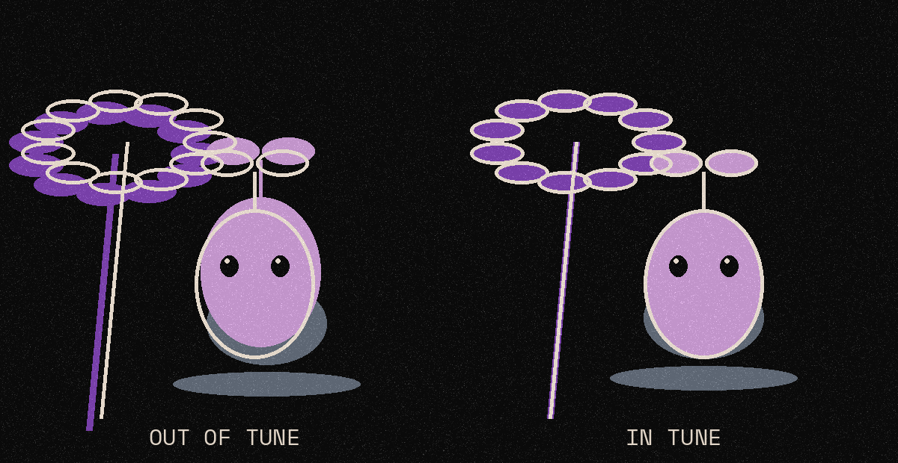
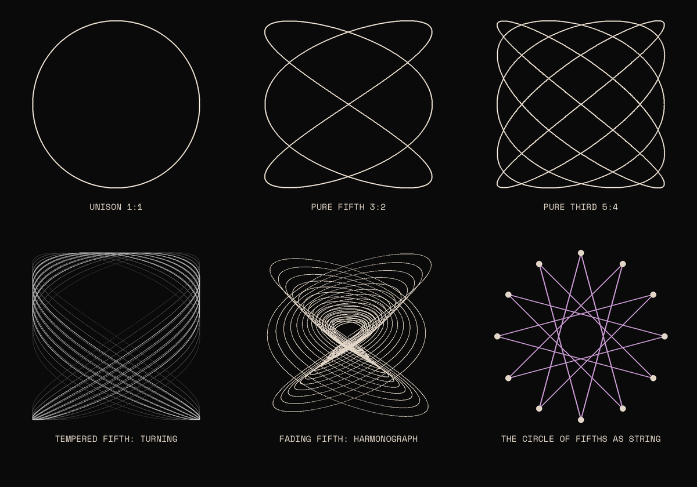
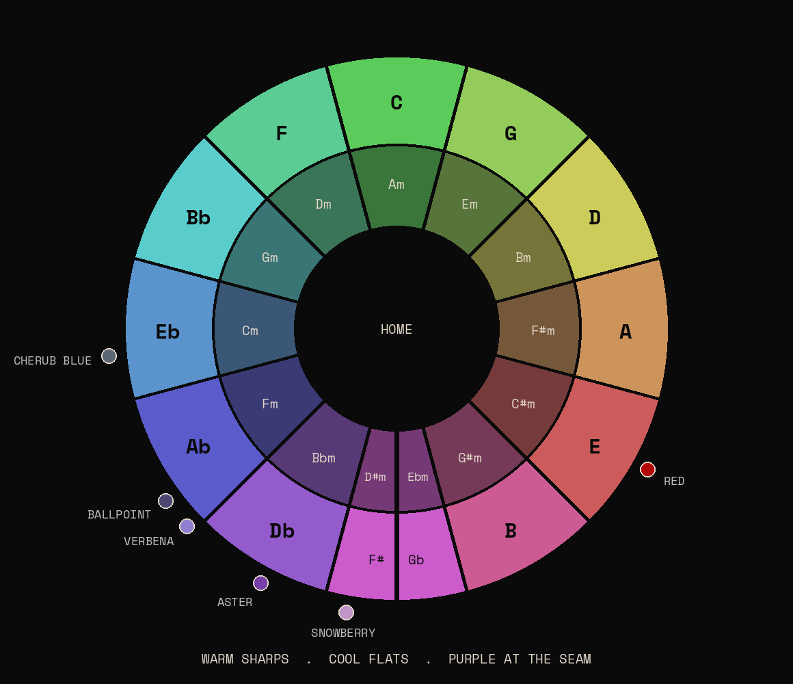

# The look: brainstorm

Brainstorm, 2026-11-13. Nothing here is decided. Morgan asked to "explore and brainstorm the ideal
visual aesthetic for the endeavour". This document goes with `shape-1-a-musical-zelda.md`,
`shape-2-volta.md` and `shape-3-the-lake-ring.md`.

The images in `img/` are flat 2D sketches of ideas, made for this document. They are not game art.

---

## What this screen can hold

The screen and the chip are design facts, not just limits.

- **Pixels near the edge of sight.** 640×480 on 3.5 inches is about 229 pixels per inch. Held at
  arm's length, one pixel is about the smallest thing the eye can see.
  - A one-pixel line looks like a fine pen line, so thin lines are a strength.
  - Detail finer than a few pixels blurs into tone.
  - Big shapes, strong silhouettes, clear light-against-dark and few colours carry the picture.
- **Eight-bit colour bands.** Smooth gradients on this panel show steps. Film grain or dither hides
  them, so a little grain is useful, not just a style.
- **A fixed pace.** 58.5 frames a second, locked to the display; missing a frame halves the rate.
- **Measured costs** (`docs/hardware-target.md`):
  - About 50 full-screen layers of blended pixels per frame.
  - One full-screen textured layer costs about 0.55 ms.
  - Shader arithmetic is 7.2 GFLOPS (15.8 at half precision).
  - About 1,300 draw calls per frame.
  - Textures upload at about 200 MB/s, so big textures can't be streamed in during play.
- **What the first toy taught.** Its full-screen water shader cost 24.5 ms at full resolution and
  7.3 ms at half. Per-pixel loops and maths are expensive here. Work per vertex, textures, and
  effects at half or quarter resolution are cheap.
- **What that means for the look:** light worked out per vertex, haze for distance, a few big
  shapes, fine lines for detail, and full-screen effects at reduced resolution.

---

## Directions

### 1. Noon and 2am

The Khole Caddy book says "the car at 2am and the garden at noon are the same figure, seen at
different hours."

- **The idea.** The day cycle is the book's two halves.
  - **Noon:** backlit garden, low sun through flowers, deep shadows, about 10% desaturated, one
    subject at full colour.
  - **2am:** black field, chrome, one hard light, blacks crushed to Void.
- **Why it fits.** Garden's lush meadow mockups live at noon; Khole Caddy's chrome lives at 2am.
  Both are Morgan's, and this way one world holds both.
- **Cost:** low. It is lighting and colour, not extra geometry.

### 2. Light made of sound

- **The idea.** Every light is a sound.
  - **Brightness** is loudness, rising and falling with each note.
  - **Colour** is key (see "The key wheel as a palette").
  - **Beats flicker:** two lights a little out of tune shimmer at the beat rate.
  - **Silence is dark.**
- **At 2am** this is literal: you see by calling, and creatures are lit by their own voices.
- **At noon** the sun is the loudest voice, a held drone in the sky, and everything else glows
  faintly under it.
- **How.** A handful of sound-lights per vertex, plus a soft glow made by blurring the bright parts
  at a quarter of the resolution.
- **Cost:** low to moderate. Vertex cost is the unknown until the meadow benchmark runs on the
  handheld.

### 3. The screenprint world

- **The idea.** The picture is printed in two or three inks on black, like a screenprint. That is
  the book's discipline ("two to three inks in print. Screenprint discipline applies to digital
  too.").
- **The key move: registration is consonance.**
  - When something is out of tune, its inks slip out of register and you see its colours doubled
    and offset, wobbling at the beat rate.
  - When it comes into tune, the inks snap into register with a satisfying click.
  - "Beautiful and a little wrong" becomes something you can see and fix with your voice.
- **How.** Draw the 3D scene into a texture (the meadow toy can already do this). Then one final
  pass separates it into inks by tone and offsets each ink by a few pixels according to dissonance.
- **Cost:** estimated 1.5–2 ms at full resolution, about 0.5 ms at half (three texture reads per
  pixel, from the measured 0.55 ms per layer).

### 4. Lines made of ratios

- **The idea.** Fine bone and chrome lines are the music made visible.
  - Each voice draws the figure of its own note against yours: still and closed when pure, slowly
    turning when tempered, spiralling inward as it fades.
  - The circle of fifths drawn as string is a twelve-pointed star.
- **Why it fits.** The book's sigil is a ballpoint string-art hourglass. String art (straight lines
  between points on circles, making curves) is exactly how ratios draw themselves. The sigil itself
  stays Morgan's (the book says it is "never redrawn by anyone else"); the game's figures are
  generated from the music.
- **Living lines wobble.** In hand-drawn animation, lines jitter slightly from frame to frame
  because each one is redrawn by a hand (animators call it "boil"). Living things' lines boil; the
  Grid's lines are perfectly still.
- **Cost:** very low. Lines are thin strips of triangles and cover few pixels.

### 5. The relic garden, from a seed's height

The book's six pillars become places, and its props become landmarks the size of mountains.

- **The garden** (noon): asters, verbena and snowberries as trees and cathedrals; alfalfa as a
  forest.
- **Relics** (noon):
  - A plaster cherub half-buried in the flowers, as a colossus. It would be an original figure; the
    book's own cherub stays a seal ("never redraw it cuter, cleaner or as a cartoon").
  - A Glencairn glass as a crystal tower that rings when you sing its note.
  - Cherry tomatoes on black knit.
- **Junk and camp** (noon): a toy Cadillac on a play-town rug, loud sunglasses, a tiara, a pink
  candle.
- **Chrome and night** (2am): the inside of a car as a cathedral of chrome. The speedometer needle,
  the mirror, and a radio dial: a giant tuning dial.
- **Salt and highway** (2am): salt flats, the lake at low water. This is wasatch's lake, whose level
  decides whether the music comes home.
- **Stage and shadow** (2am): one red bulb, haze, loops stacking.
- **Same figure, different hour.** Each place has a noon face and a 2am face, which fits the
  circle: a place and its other hour could sit opposite each other, a tritone apart.
- **"Pretty on top, rot underneath."** Flowers growing through a rusted bumper. This is a strong
  direction only if the game is partly a Khole Caddy piece; it is Morgan's call how much of the
  book's world comes in.
- **Cost:** low. Big simple shapes, lit per vertex.

### 6. The past in sun-print blue

- **The idea.** Echoes and memories (shape 2's past selves, any flashback) appear in cyanotype blue,
  the colour of a sun print. The book gives that colour to relics ("Relic pieces lead Cherub Blue").
- **Old and retuned.** Old echoes fade like over-exposed prints. A retuned echo takes on a little of
  today's colour.
- **Cost:** none; it is a tint.

### 7. Quantising as the uncanny, misregistration as the ache

- **The Grid's touch is quantisation made visible:**
  - Colours band into flat steps, like an image saved with too few colours.
  - Animation stutters onto a fixed grid of moments.
  - Geometry snaps to a coarse grid, so edges jitter like old PlayStation graphics.
  - Grain disappears, lines stop boiling, and everything becomes chrome-grey and perfectly clean.
  - It is the only clean thing in the world, and that is what makes it wrong.
- **The Wolf's touch is error you can see:** doubled images out of register, flicker at the beat
  rate, and the only red in the world in its eyes, like tail lights. The book: "Red: found light,
  never a fill."
- **Cost:** none to speak of; these are switches in the final pass.

### 8. The painterly road (and why not as the base)

- **What it is.** Soft cel shading, painterly textures, lush greens, blue distance: Breath of the
  Wild, Tears of the Kingdom, Garden's mockups. It's loved for good reason.
- **Why not as the base:**
  - Much of its richness is per-pixel work and large textures, both expensive here.
  - It would look like a smaller Zelda.
- **What to borrow:** the three laws from Garden's own TOTK study, all cheap.
  - **One ground colour** that everything planted in it takes on, so the world reads as one
    painting.
  - **One wind** that everything sways to.
  - **Hue belongs to one thing:** here, the key. Weather and night only change brightness.

### 9. Plaster and stop-motion

- **The idea.** Creatures look cast, not modelled: matte plaster in Bone, chunky and simple, like
  the book's relics.
- **On twos.** Their poses update about 12 times a second, as in stop-motion, while the camera and
  the world move smoothly. Spider-Verse mixed frame rates this way.
- **Why.** It feels handmade, and it is cheaper to animate.
- **What to watch:** in fast combat, stepped poses can make timing harder to read, so test it.

---

## The synthesis I'd choose

**Bone and chrome on black. One garden colour per key. Light made of sound. Lines made of ratios.
The past printed in blue.**

### By day (noon)

- The meadow from a seed's height, backlit, haze in the distance.
- The book's 70 / 20 / 10, adapted for daylight:
  - 70% quiet ground tones (desaturated greens, greys, earth);
  - 20% bone and chrome highlights;
  - 10% the day's key colour, carried by the one thing that matters.

### By night (2am)

- Literally 70% Void.
- Light only from voices, the moon, and the one red bulb.
- Chrome catches whatever sings near it.

### Creatures

- Matte plaster bodies in Bone, with simple silhouettes that read at a glance.
- Two dark eyes, each with a glint that stays bright in any light. Garden's study found that at this
  scale players read silhouette and eyes and little else.
- A creature's colour lives in its voice: when it sings, a fine line figure blooms around it in its
  key's colour.
- No human faces (book rule 1).

### The beloved

- Seen clearly only when you're in tune with them. Out of tune, their inks drift out of register;
  in tune, they come into focus. "I see you."

### The music layer

- Fine lines, boiling when alive: figures around voices, rings of light from calls, the
  twelve-pointed star where the circle shows itself, an hourglass of string where time pours.

### The past, the Grid and the Wolf

- **The past** is sun-print blue.
- **The Grid** is banded, stuttering, snapping and grainless.
- **The Wolf** is doubled, flickering, with red eyes.

### Words and screens

- Almost none. Shape 2 has no HUD at all.
- Where words are needed: Space Mono, set wide, one line at most, plain punctuation. The book:
  "Silence is a valid caption."
- The songbook is ballpoint on bone paper, the one place the book's Ballpoint colour belongs ("on
  paper only").

### Camera and motion

- The creature in the lower third, with the sky above it.
- A slow push-in for focus; cuts on the beat, or fades through black, as the book asks of video.
- Hits stop the picture for two or three frames instead of shaking it: a musical rest, a staccato.

### Texture

- One pass, always: fine film grain at 6–10%, which also hides the panel's colour banding (the
  book's default texture).

---

## The key wheel as a palette

- **Hue follows the circle of fifths.**
  - C at the top is green.
  - The sharp keys run warm clockwise: G yellow-green, D yellow, A orange, E red, B rose.
  - The flat keys run cool counter-clockwise: F teal, B♭ cyan, E♭ azure, A♭ blue, D♭ violet.
  - Both sides meet at F♯/G♭ in purple.
- **Why purple sits at the seam.** Purple is the one colour the eye invents to close the rainbow
  into a wheel; it has no wavelength of its own. So the comma, where the circle of fifths doesn't
  close, sits where the eye fakes its own closure. That is designed, and it is true twice over.
- **The book's palette lands on the dark side and the seam.**
  - Cherub Blue is near E♭.
  - Ballpoint and Verbena are near A♭.
  - Aster is near D♭.
  - Snowberry is at the seam.
  - Red is at E.
- **The other mapping.** The physics mapping (a note raised forty octaves into light) follows
  pitch, not fifths, so it puts harmonic neighbours far apart in colour. The game uses the fifths
  mapping because kin should look like kin. The two mappings happen to agree on two notes: C is
  green and A is orange in both.
- **Fixed inks that never change with key:** Void #0A0A0A, Carbon #141414, Bone #E2D6C8, Chrome
  #C0C0C0, Red #B20402 (found light only).
- **Rules:**
  - **Hue** is key.
  - **Brightness** is the mode (sharper modes brighter) and loudness.
  - **Saturation** is consonance. Two tones a tritone apart sit opposite on the wheel; their lights
    mix toward grey. Dissonance drains colour, and resolution restores it.

---

## How it fits the chip

| effect | how | cost |
|---|---|---|
| lighting, haze, wind | per vertex | small; the meadow benchmark will measure vertices |
| screenprint inks and registration | one final pass, three reads per pixel | ~0.5 ms at half resolution (estimate) |
| grain, banding, Grid and Wolf switches | inside that same pass | almost nothing |
| glow from voices | blur of bright parts at quarter resolution | under 0.5 ms (estimate) |
| line figures | thin triangle strips | very small fill |
| sky | one full-screen pass, two texture reads | about 1 ms (estimate) |
| shadows | soft blobs only | tiny |

- **Estimates** come from measured per-layer costs. Nothing here has been measured on the handheld
  in a real scene yet.
- **Frame budget:** 17.1 ms. I'd keep the full 58.5 Hz for combat and music timing, and draw the
  3D view at 75% resolution if a scene needs it (the meadow toy already supports that).

---

## What to test first

In the meadow toy, on the handheld:

1. **The ink pass:** two or three inks, grain, and registration tied to how in tune you are.
2. **Night:** light only from voices and calls.
3. **The Grid:** banding, stutter and snapping.
4. **The past:** an echo in sun-print blue.

And the benchmark the meadow toy is waiting to run, so the vertex budget stops being a guess.

## Open questions

- How much of the Khole Caddy book's world (its props, its pillars) belongs in the game, as opposed
  to only its eye.
- Whether stepped animation hurts combat readability.
- Whether the ink pass reads on the small screen or just looks blurry. It has to be tried on the
  device; a laptop monitor will lie.
- How bright a night scene can be on this IPS panel before Void stops looking black.
