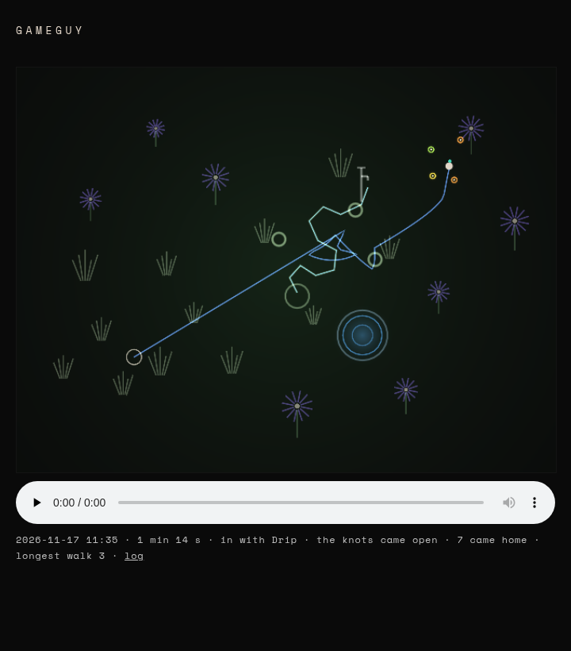

# The card

> **Status, 2026-11-26.** History and material (2026-11-17): what the game card could be for. The
> direction does not yet say what the card holds beyond takes and saves. What the game is:
> `design/the-game.md`.

_On 2026-11-17 Morgan asked "what the best use of the game card is", and then: "the card is only
32GB... think about the scope and size of the game in it's ultimate form... be realistic about the
best use... ambitious and realistic. role play different humans playing the game". Both handhelds
have a 32 GB card in the TF2 slot, erased, with one exFAT partition named GAMEGUY: about 30 GB to
use. A first version of the book is built into the page toy and its launcher (`toys/page/`) and was
tried on the purple. Nothing here is decided._

## The idea in one breath

The card is the world's memory. The game keeps each day as what your hands did, the take: about a
quarter of a megabyte. Played back, a take makes the same world and the same sound on any machine;
the laptop and the purple already agree to the last bit. Sound, pages, notes and video are copies
made from takes, whenever someone wants them. So 32 GB isn't small: the whole game, even at the
scope of Tears of the Kingdom, and years of play fit in a few gigabytes. The card should be the
game's own, and the game should live on it (below). Only one thing could fill the card, and that's
keeping sound, which can always be made again.

## How big the game is

### The game itself, in its ultimate form

**Corrected the same evening.** This section first said the game would be under 150 MB. That left
out the world itself: the places, built by hand at the density of Tears of the Kingdom, which Morgan
asked for ("a seriously AAA game"). They are data as well as code. The full estimate is in
`the-whole-game.md`, "How big it would be"; in short:

| part | size |
|---|---|
| the program: rules, sound, drawing | 5 to 30 MB |
| the places, built by hand: about 25 of them | 0.1 to 0.5 GB |
| the lands of thirds, after the ending | under 1 MB, made from rules |
| sound made live | nothing stored |
| recorded sound, if Morgan wants it | 0.1 to 3 GB |
| type, words, Khole Caddy's art if it comes in | a few MB |
| **the game** | **0.1 to 0.5 GB with sound made live; up to about 4 GB with recordings** |

Tears of the Kingdom needs 16.3 GB on a Switch, most of it textures, models, recorded sound and
video. Here those are rules and sound made live.

### Where the game lives: on this card

- **Size.** At the top of the range the game outgrows the built-in storage where games go (`/roms`:
  774 MB free on the purple).
- **Smoothness.** Reading the built-in storage costs the processor 1,100 to 5,000 interrupts per 256
  KB, which is what stalled frames earlier. The card costs 12 or fewer. A world that loads as you
  walk has to load from the card.
- **Safety.** The card is the game's own, not a stock card shared with other games. The handheld
  keeps its own copy of the world (rule 4, below).
- **Recordings don't have to fit in memory.** They stream from the card: a lossless stereo stream
  needs about 0.2 MB a second, and the card reads 43.

### What a day of play makes

A day in the canon lasts about twenty minutes (section 4).

| what | a day | how known |
|---|---|---|
| the take: everything your hands did | 0.1 to 0.25 MB | estimated from a simulated day of hands, packed: 0.1 MB if the game steps at a fixed rate, 0.25 MB if it also keeps its clocks, as the toys would now |
| the morning's save | under 0.1 MB | estimated |
| the river's song, half a minute | 2.9 MB as WAV, 0.7 MB as FLAC | measured from the purple's song |
| the pressed page | 0.06 MB | measured, as a packed PNG |
| the day's notes, as a MIDI file | under 0.1 MB | estimated |
| the whole day's sound | 115 MB as WAV, 29 MB as FLAC, 5 to 13 MB as Opus | measured: 76 seconds of the page toy, encoded each way |

The seven imagined players took five to eleven weeks of evenings and breaks to reach the thirteenth
morning (`playthroughs/`). After it the days never run out, so a devoted player could give the game
hundreds of hours.

### How long 30 GB lasts

| keeping | an hour of play | the card holds | at an hour a day it fills in |
|---|---|---|---|
| the whole sound as WAV (what the toy's book does now) | 346 MB | 87 hours | 3 months |
| the whole sound as FLAC (lossless) | 88 MB | 340 hours | 11 months |
| the whole sound as Opus (good quality) | 40 MB | 760 hours | 2 years |
| takes, saves, pages, notes, and the river's song as WAV | 10 MB | 3,000 hours | 8 years |
| takes alone | 0.75 MB | 40,000 hours | over 100 years |

## One take, two machines (measured)

- `toys/wheel/tools/same-take.zig` runs the wheel toy's rules and sound with no picture. That means
  twenty minutes of play at 60 steps a second: the scripted player, plus a seeded scatter of extra
  walks, calls and dodges.
- After every minute it prints a fingerprint of the world (every creature, every event) and of the
  sound (every sample).
- On the laptop and on the purple, all twenty fingerprints of both kinds were identical. That covers
  2,515 events and 57.6 million samples, on two kinds of processor with two different system
  libraries.
- **Corrected the same evening.** The first run never built the synth's wavetables, so the sound
  both machines agreed on was silence. The world's fingerprints stood. With the test fixed, the
  laptop and the purple matched again on all twenty minutes, world and sound, with the sound
  reaching 0.946 of full scale. Other builds of the same test, WebAssembly and C among them, are in
  `docs/other-platforms.md`.
- **Why it holds.** The maths the rules use (sine, exponential) is built into the program by its
  compiler, not borrowed from each machine's own library, so both machines do exactly the same
  arithmetic.
- **Speed.** With real sound, the purple worked out the twenty minutes in about 3 minutes 38 seconds
  on one core, just after starting up. That is about five and a half times faster than playing them,
  so the handheld can make any day's sound again when it is asked for. (The morning's 3 minutes 16
  seconds was the silent run.)
- **The picture** is drawn from the world. It can differ by a shade between graphics chips, and
  nothing in the world depends on it.
- **Not covered yet.** This ran at fixed steps. On the handheld the toys take their time from the
  screen and the sound card, so a take of a toy session would need its clocks as well. The canon
  already asks for fixed steps (section 15), and the game should be built that way from the start.

## Eight humans and the card

_Role play, 2026-11-17. The seven players from `playthroughs/`, a year on, with a card in the
handheld; then what it would do for Morgan. Imagined, like the diaries._

**Rosa, 34, night nurse.**

> My card is the one the handheld came with: Pokémon, four thousand games my nephew put on, and
> this. I've never taken it out; I wouldn't know how. In March it went funny and Pokémon lost a
> save. The lake didn't: "the handheld kept a copy", and on it went. I play in bits, so one day of
> the game takes me three breaks. The river's song is what I listen to on the bus home, on the
> handheld, one earbud in. I've never seen the book on a computer. I haven't got one.

- **What it shows:**
  - Most people never take the card out, so the book has to be readable on the handheld.
  - Days are played in pieces, so the book goes by days, not sessions.
  - Stock cards fail, so the card can't hold the only copy.

**Theo, 16, drummer.**

> Rafi put the game on my card, which is mostly PSP games. Two gigs free. If it had kept the sound
> of every session, like the first version, it would have filled my card in a week and taken my PSP
> saves with it. Takes are what I care about. My best fight is smaller than a photo; I posted it on
> our server and three people raced it as a ghost. What I wanted was video, and you can't film a
> screen this small under a blanket. Rafi's laptop played my take and made a clean video of it: same
> hits, same frame of the clap.

- **What it shows:**
  - Shared cards are full, so the game stays small by default and never fills a card.
  - Takes are what people share.
  - Video is made on a computer from a take. It is never recorded on the handheld.

**Walt, 71, trumpet.**

> I don't touch the card. Nate does, at Christmas. He took it home and came back with two things. A
> CD for the car: thirteen tracks, one for each morning, the river's songs in order, six and a half
> minutes. Ray's board tape all over again. And the thirteenth page, printed big and framed. He said
> his computer drew it again from the take at poster size, the lines as fine as a pen's. It's over
> the TV. I can see it without my glasses.

- **What it shows:**
  - The book is for the family too.
  - Songs have to play in ordinary players, so the river's songs are plain WAV.
  - Pages are lines, so they can be drawn again at any size for print.

**Priya, 27, software engineer.**

> Every Sunday I copy the card to the laptop. Notebook #9 has the take format worked out by hand;
> then I found it written up in a README on the card, which annoyed me in a good way. I plotted
> every walk I took round the lake, eleven weeks in one picture. I went back to the night before the
> thirteenth morning to try each offer, then put the duet back. The only thing on the card that
> wasn't information would have been sound, and I could have any day's whenever I asked.

- **What it shows:**
  - Plain, documented files.
  - A save every night that you can go back to.
  - Sound as a copy, made on request.

**Kai, 9, and his mum Lena, 40.**

> *Lena:* Summer holidays, two hours a day. Once a month I put the card in our laptop and copy the
> book into the family photos, like his drawings, and the songs go to Uncle Dev. Kai wanted to swap
> cards with Ollie at school "to visit his lake". I said absolutely not: Ollie's brother lost a game
> card last year. What they did instead was copy. Ollie's lake came home on a spare card, Kai walked
> round it, and his own card never left the handheld.
>
> *Kai:* Ollie's lake has more wolves than mine. I sang them into puppies.

- **What it shows:**
  - Heavy play is fine if sound is kept a night at a time. The first version's whole-session sound
    would have filled the card in six weeks of his summer.
  - Your card is too precious to hand over, so what travels is a copy on a second card.

**Imani, 52, choir director.**

> I asked for two things, and both came from the take, not a recording. The first was the day's tune
> as notes: the river's song came out as a MIDI file I opened on the church laptop, and the altos
> sang Hum's line against the vine's. The second was a way to show thirty singers what a pure fifth
> looks like when it slows. The laptop played my Tuesday on the projector, the size of the wall.
> When I paused it, the figure stood still and closed.

- **What it shows:**
  - To a musician, notes are worth more than sound, and they cost almost nothing to keep.
  - A laptop that replays takes lets a teacher show the game to a room (`experience-fixes.md`).

**Ash, 26, and Bea, 23, sisters.**

> *Ash:* Six weeks on one couch, then Bea moved out. On the couch the cable joined the consoles and
> each kept both our takes, so both our books have those evenings as duets, her thirds and my tune
> together. Since she moved, our letter is a card in an envelope with a stamp on it. It carries my
> last few days and a copy of my lake, and hers comes back the same way. It's never the card our own
> worlds are on. Those don't leave the handhelds.

- **What it shows:**
  - A duet needs both takes in one place, and the cable already allows that.
  - A card can travel by post.
  - The letter card is a different card from your world card.

**Morgan.** _Not role-played: what takes would do for the two of us now._

- Every session you play on the black would leave its take on the card. You'd say a moment clicked,
  or felt off; I'd pull the take over the cable and replay that minute on the laptop. It would be
  the same world, the same notes on the same beats, with the picture at any size. Your reports could
  point at seconds.
- And since you're an audio engineer: any day you liked could come out as studio sound, every voice
  on its own track, without the handheld ever recording a whole day.

## What they show

1. **Keep what happened, not what it sounded like.** Takes are the truth. Sound, pages, notes and
   video are copies, made on the handheld or on a computer when someone wants them.
2. **The book is read on the handheld first.** Most players never take the card out (Rosa, Walt,
   Kai). The canon's D-pad already sits and listens and plays a kept song (section 5), so the book's
   pages and songs belong there. The computer page is a bonus.
3. **The book goes by days, not sessions.** A day played over three breaks is one page (Rosa).
4. **The card is never the only copy.** Stock cards fail (brainstorm 3.5), and the black's own stock
   card claimed 189 MB it didn't have (brainstorm 29). Children and friends lose cards (Lena).
   - The handheld keeps its own copy of the world.
   - It is written at the river, when nothing is moving, because writing to the built-in storage can
     stall a frame (`docs/hardware-target.md`).
5. **Small by default; never fill a card.** Shared cards are full of other games (Theo). By default
   the game keeps what it needs plus half a minute of song a night, and leaves a margin free.
6. **Copies for people:**
   - plain WAV for songs, for cars, CDs and messages (Walt, Lena);
   - MIDI for musicians (Imani);
   - pages that redraw at any size (Walt's frame);
   - video and the projector, from a laptop (Theo, Imani);
   - separate tracks for Morgan;
   - documented files for Priya.
7. **Letters are copies.** A letter card carries a copy of your lake and your last few days, and
   your own card stays home (Kai, Ash and Bea). A visit, your Hum in someone else's lake, is
   something else: it goes over the cable (`together.md`).

## The best use, revised

### 1. The world's memory

- **Every take, kept for good.** The world itself needs them:
  - pools show what happened beside them and play back what you released (`memory-in-rhythm.md`
    section 4, `experience-fixes.md`);
  - dreams join paths from different days;
  - the Grid compares days;
  - the Wolf is the echoes you never released;
  - the vine hums yesterday back.

  Four takes walk with you as echoes, and the card keeps them all, at about a quarter of a megabyte
  a day.
- **A save every dawn,** so Repeat can relive a day and a player can go back to any night.
- **The handheld's own copy** (rule 4).
- **Every version of the game that wrote a take,** so any day from any year replays exactly: the
  program each time (5 to 30 MB), and the places only when they changed.

### 2. The book

- **One page a day:**
  - the pressed page;
  - the river's song (half a minute, WAV);
  - the day's notes (MIDI);
  - the take;
  - a line of facts.
- **On the handheld,** inside the game: at the river, or sitting by a pool, every kept song and
  page, newest first.
- **On a computer:** `index.html`, as now.
- **On request, from any day:**
  - its whole sound, as one file or with every voice on its own track (the handheld makes a
    twenty-minute day in under four minutes; a laptop is faster);
  - a video at any size (on a laptop);
  - the page at print size.

### 3. Two consoles

- **In one room, the cable.** Each book keeps both takes, so an evening together is a duet in both
  books. What the two consoles can do together over it, visits included, is in `together.md`.
- **Apart, a letter card:** a second card, carried or posted, with copies of lakes, echoes and
  songs.
- **Swapping your own card** still works (the launcher looks for a card again when the game starts),
  but it's no longer the plan.
- **Letters through the TF1 slot** are out on the black, whose TF1 slot doesn't latch (brainstorm
  27.1).

### What stays empty, and why that's right

- At an hour a day, all of the above comes to under 4 GB a year, mostly the river's songs. The card
  holds about 30 GB.
- Most of the card will stay empty for years. That isn't waste: the space isn't needed because takes
  work.
- If Morgan wants every day's whole sound kept anyway, lossless, the card holds about 340 hours of
  it. The oldest can always go first, because each can be made again.

## What changes from this morning's version

| this morning | now |
|---|---|
| a page per session | a page per day |
| the whole session's sound as WAV, 346 MB an hour | the take and the river's half minute; a whole day's sound only when asked for |
| the page as an unpacked PNG, 0.9 MB | packed, 0.06 MB |
| the card holds the only copy | the handheld keeps a copy of the world |
| the cartridge: hand over your card | a copy on a letter card; visits over the cable (`together.md`) |
| letters through TF1 | not on the black (its TF1 slot doesn't latch); a second card instead |

## What the toys could do next

- **Record the take in the page toy:** everything the world is fed each frame, clocks included,
  written to the card as the session runs. Writing to the card costs the processor little (measured
  below).
- **Replay it** with `--replay TAKE`: the same world on the laptop or the handheld, with sound and
  frames written out. Then every session played by hand on the black can be replayed exactly.
- **Then drop the whole-session WAV** from the book, or keep it only while testing.
- **For the game:** fixed steps, as the canon says, so a take is only its hands.

## What the card is good at (measured)

On the purple, 2026-11-17, a fresh 32 GB SDHC card in the TF2 slot (`docs/hardware-target.md`):

| | |
|---|---|
| finding it again (the TF2 slot only) | 0.9 s |
| checking it for damage | 0.3 s |
| mounting it | 0.4 s |
| writing 64 MB | 31 MB/s |
| reading 64 MB | 43 MB/s |
| a 4 KB journal entry, pushed out to the card | 1.6 ms typical, 4.4 ms for nine in ten, 49 ms worst in 200 |
| a crash-safe 64 KB save (new file, pushed out, renamed over the old) | 9.5 ms typical, 13 ms worst |
| work for the processor, per 256 KB read | 12 interrupts or fewer (the built-in storage: 1,100 to 5,000) |
| per 256 KB written in small pushes | 410 to 460 interrupts (the black's card, the same model) |
| per 256 KB of one long write | 52 interrupts |

- **It is light.** Reading the card costs the processor about a hundredth of what reading the
  built-in storage does, and writing costs a third to a tenth as much. So the game can write takes
  while you play.
- **It is exFAT,** which any computer reads.
- **It can be found again without a restart.** The TF2 slot only looks for a card when the handheld
  starts, and the launcher can make it look again.

## How the built part works

The page toy's launcher (`toys/page/port/GameguyPage.sh`):

1. **Find a partition named GAMEGUY on an SD card.** It is never the built-in storage, which is not
   an SD card.
2. **If there is none, ask the TF2 slot to look again.** It only does that if:
   - the slot is the one it knows (`ff380000`);
   - nothing in it is mounted;
   - the system does not live on it.
3. **If the card is already mounted** (ArkOS mounts its second card at `/roms2`, for instance), use
   it there.
4. **If not,** repair it quietly (`fsck.exfat -p`, in case a power cut left it half-written) and
   mount it for this session only.
5. **Run the toy** with `--book` on the card, or the card's own copy of the program if it has one.
6. **Afterwards,** rebuild `index.html` from whatever is on the card, write a `README.txt` if there
   is none, push everything out and unmount.
7. **With no card,** everything is as before: the session log stays on the handheld.

Choices made for a handheld that can lose power at any moment:

- **The card is mounted only while a session runs,** so switching off in the menu can't catch it
  half-written.
- **The song is always playable.** Its header is brought up to date every ten seconds, so a session
  cut off still leaves its sound.
- **The index is rebuilt from what is there.** A session that ended badly still shows, as "cut off
  before it ended".
- **The sound thread never waits for the card.** It copies each buffer into a ring, and the main
  thread empties the ring to the card once a frame.

Measured on the purple with the scripted player over 4,270 frames:

- 17.10 ms a frame;
- 2 frames one frame late, the worst 34 ms;
- no sound gaps.

The book got 7.3 MB of song for 76.5 seconds and a 0.9 MB page.

## What ArkOS offers instead, and why not

- ArkOS has "Switch to SD2 for Roms". It mounts the card at `/roms2` and moves the whole menu there:
  - every system's folder (more than 120);
  - all the ports;
  - the tools, the file browser, the background music and the settings of a dozen emulators.
- It is built for emulator libraries, and this game needs none of it.
- Its way back assumes a different layout (it mounts `/dev/mmcblk1p5` as `/roms`). On these
  handhelds `/roms` is on the built-in storage, so it wasn't tried.
- The doorway works with it anyway: if ArkOS has mounted the card, the launcher uses it where it is.

## For any R36S owner

- Most R36S owners run the system from TF1 and keep their games on TF2, on the card the handheld
  came with.
- That card is usually full and often failing (Rosa, Theo). So the game keeps its world wherever it
  is installed, small, with two saves and a journal. A card named GAMEGUY is a bonus, not a need.
- The launcher looks for a partition named GAMEGUY on any SD card. It only asks a slot to look again
  if it is the slot it knows and holds neither the system nor anything mounted.

## Saves (not built yet)

exFAT keeps no journal, and handhelds lose power. The plan, from the measurements above:

- **The day's take goes to a journal file** as it happens, 4 KB at a time, pushed out at once.
  - That costs 1.6 ms typically and 49 ms at worst, so a writer thread does it, never the frame
    loop.
  - A power cut loses at most the last few seconds.
- **A save is written as a new file,** pushed out, then renamed over the old one: 9.5 ms.
  - The two newest are kept, each with a checksum.
  - On start, the newest that checks out is used.
- **A save at every dawn is kept for good.** They are small, and they let a player go back to any
  night.
- **At the river, the world is copied to the handheld's own storage** (rule 4).
- **The launcher repairs the card before mounting it.**

## What it would change

| in | now | with this |
|---|---|---|
| canon section 4, the river | sings your day back | its song, its page and its notes go in the book, a page a day |
| canon section 13, two consoles | "SD card: trade echoes" | the cable in one room; a letter card between rooms (visits: `together.md`) |
| canon section 15, the hardware | "a take is its inputs" | measured: one take plays out bit for bit the same on the laptop and the handheld |
| `memory-in-rhythm.md`, pools | pools remember | they can: every take is kept |
| the toys | results on the handheld; a book of whole sessions | takes and replays next |

## Not yet connected

- **Designed, not built:**
  - takes;
  - replays;
  - the notes as MIDI;
  - the book on the handheld;
  - the handheld's own copy;
  - letter cards.
- **Formats.** The river's songs are short, so WAV costs little and plays everywhere.
  - FLAC is a quarter of the size of WAV for this music, and lossless.
  - Opus is smaller still but needs an encoder on the handheld.
  - Whole days are made on request, so their format can be chosen then.
- **The whole session or the river's half minute.** For the game: the river's half minute, and any
  whole day on request. For the toys while testing, Morgan's call.
- **The book's look** is plain: black, bone, the page, the song. It could be designed as a book.
- **Time zones.** The purple's clock was set right on 2026-11-17 (it read April). Its time zone is
  New York, as the golden image set it, so the book's times are New York times.

## Sources

- Measurements on the purple, 2026-11-17:
  - this document's sizes;
  - the same-take check (`toys/wheel/tools/same-take.zig`);
  - the card (`docs/hardware-target.md`).
- Sizes of sound: the purple's 76.5-second song, encoded with FFmpeg (FLAC level 8; Opus at 32 kbps
  constrained and 64 kbps).
- The take's size: a simulated twenty-minute day of hands and clocks, packed with zstd. An estimate,
  not a measurement of real hands.
- ArkOS's `Switch to SD2 for Roms.sh` and `Switch to Main SD for Roms.sh`, read on the unit
  (`/usr/local/bin/`).
- This repo:
  - `thirteenth-morning.md` (sections 4, 5, 13 and 15);
  - `playthroughs/`;
  - `experience-fixes.md`;
  - `memory-in-rhythm.md`;
  - `drawn-in-light.md`;
  - `r36s-game-brainstorm.md` (sections 3.5, 17, 18, 27.1 and 29, and question 23);
  - `toys/page/README.md`.
