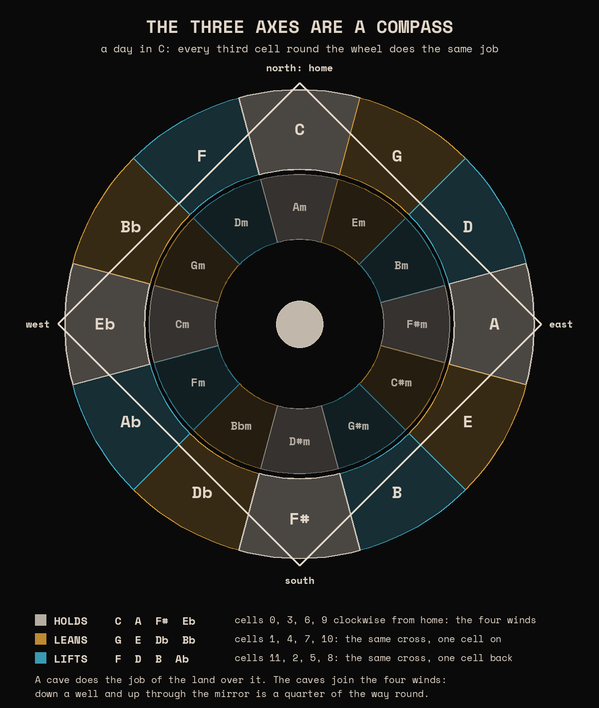
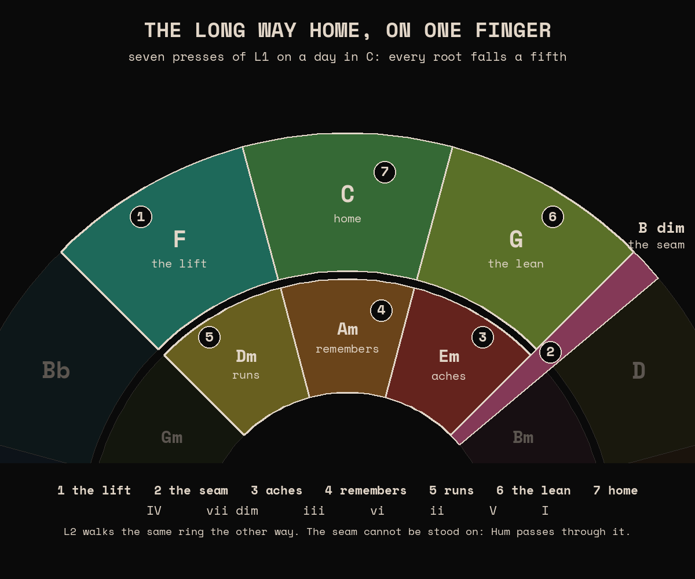

# The depths

> **Status, 2026-11-26: the direction,** with `the-game.md` and `the-wormhole.md` (Morgan: "this is
> absolutely 100% the direction"). Read `the-game.md` first.

_Part two of `the-game.md`, written 2026-11-25 by Claude under the same permission. Morgan was
watching a video about the chord on the third note of a key, sent three pictures from it, and asked:
"have we identified the experience around how these depths of theory may be manifested in the world
we're shaping?" He named inversions, voice leading, the wonders, the great instruments of each land,
endless composition, and "RHYTHM & NUANCE OF THE POCKET", and asked: "what's that about not being
able to make a 3rd???" Everything here was my call; on 2026-11-26 he made it part of the direction,
and it stays his to change._

_The notebook already held a good deal of this, in `spec/world.md` (2026-11-19 and 20): a great
instrument and a metre for each of twelve lands, 144 wonders, and a world past the lake that never
ends. That file is history now, but this part keeps those pieces by name, and adds what was missing.
Its wonders are nearly all about sound itself. The depths of harmony and of time had no place yet._

## The third: what I said wrong

Part one said "The third comes from someone. No stack of fifths makes it." As written that is wrong.
Hum can make a third. Here is what is true.

- **The sweet third is already inside one note.** A voice with any brightness sounds its note and
  that note times 2, 3, 4, 5 and on. The one at five times is two octaves and a pure major third up:
  5/4 once the octaves are taken off, 386.314 cents. For Hum's C at 261.63 Hz it is the E at 1,308.1
  Hz.
- **Walking round the wheel reaches a different third.** Four fifths up from C is also an E: 81/64,
  407.820 cents. It is 21.506 cents sharper than the sweet one. That gap, 81/80, is the second small
  gap in this world, the one inside every key.
- **A piano hides it** by putting E at 400 cents, 13.686 wide of sweet. That is the treaty again.
- **So the true sentence is:** nobody arrives at the sweet third by going round the ring. Powers of
  three never land on five. The ring of lands is made of fifths, and the third lies in another
  direction, which in this world is down.
- **What I take back** is that only someone else can bring it. That came from shape 2 and the design
  does not need it. The truer story is better: the third has been in Hum's voice all along, too
  quiet to hear, because a closed hum has almost nothing above its bottom note.
- **Finding his voice is opening his mouth.** Sweep a mouth from oo toward ee on one held note and
  the overtones light up one after another, low to high. Overtone singers do exactly this. The new
  notes arrive in this order: the fifth (overtone 3), the third (5), the low seventh (7), the ninth
  (9). The game's swell already adds its voices in that order (`chord_ratios` in `world.zig`: 1,
  3/2, 5/4, 7/4, 9/4), and it is the order of the table in part one's "What grows".
- **The friends are vowels.** The notebook's five voices were given oo, oh, ah, eh and ee, dark to
  bright (shape 1). So each friend is the one who shows Hum where one overtone lives in his own
  voice. Someone still sings the third with him first, and who that is stays Morgan's. But it is
  found, not given.
- **One note was never a limit.** A held note with its mouth open is a chord: 4, 5, 6 and 7 times a
  low note are a root, its third, its fifth and its low seventh.

## Six questions, and where each lives in the hands

Morgan: "all of music experienced/learned/played-with/at-my-fingertips". Taken literally, music asks
six things of every sound, and each one has a place.

| the question | in theory's words | in the hands | in the world |
|---|---|---|---|
| where is the chord? | harmony, function, key | L1, L2, the click, the wheel on R1 | which places are awake; Hum's body |
| what is underneath? | inversion, bass, pedal, mode | where you stand; who sings lowest (D-pad) | whether a thing stands, slides or hangs |
| what moves? | voice leading | nothing: you watch it and walk on it | what stays is footing; what leaves slides a step |
| when? | rhythm, metre, feel | every press, and your legs | landing, lifting and leaning in time; your rut |
| who? | timbre, register | the friends; the land's great instrument | which overtones are loud, so what answers |
| how long? | phrase, form | a breath, a day, a night | eight bars a day; the island |

Part one answered the first. This part is the other five.

## The chord on your screen

### It is a cave with two mouths

- **Where it is.** On a day in C the chord in your first picture, E minor, is the cave under the
  leaning land: the one part one says aches.
- **Why it soaks things up.** It shares two of its three notes with home (E and G) and two with the
  lean (G and B).
- **In the world that is two ways in.** From the land that leans, a well goes straight down to it,
  and one note moves: D up to E. From home, a way slips under the border to it, and one note moves:
  C down to B. It is the one cave with a mouth in home and a mouth in the lean.
- **What it is depends on the mouth you came in by,** because what stayed awake is different. From
  home, home's E and G never went out and only the floor moved: it is home, hollowed. From the lean,
  the lean's G and B stayed, and its insistence went soft.
- **And on Hum.** With his note sounding, E, G, B and C together are home's own seventh chord
  standing on its third. Silent, the cave is the lean's quiet relative. His hum is what tips it.
- **And on where you go next.** Fall a fifth to the cave that remembers, and it was the first step
  of the long way home. Step up to the lift, and every voice rises together. Slip back, and you
  never left.
- **It has a twin on the other side.** The cave that remembers has a mouth in home and a mouth in
  the land that floats, and shares two notes with each. So both caves beside home soak up what is
  next to them: one between home and the lean, one between home and the lift.

### Your second picture is a compass

- **The three axes are part one's three bodies, spread over the whole wheel.** The tonic axis is
  everything that holds. The dominant axis is everything that leans. The subdominant axis is
  everything that lifts.
- **On the wheel each axis is a square: every third cell.** Count cells clockwise from home: 0, 3, 6
  and 9 hold; 1, 4, 7 and 10 lean; 2, 5, 8 and 11 lift.
- **So the dark eighteen are not strangers.** Every cell, lit or dark, already has a body. A♭ lifts.
  D♭ leans: it is the lean's twin across the lake. E♭ holds, a darker home. Borrowing needs no new
  rule.
- **A cave does the job of the land over it,** and the axes agree: D with F, A with C, E with G.
  That is why E is on the dominant axis in your picture, under the lean, while its two shared notes
  still tie it to home.
- **On the lake, the square that holds is the four winds.** On a day in C: C in the north, A in the
  east, F♯ in the south, E♭ in the west. Those are the four lands that can stand in for home.
  Morgan's worksheet gave Jeanne a compass, and its caravan "No. 27" came from "BEYOND EASTERN
  PLAINS". Twenty-seven is three fifths stacked, and three fifths from C is A, due east.
- **The caves join them.** Go down a land's well and up through the mirror at the bottom, and you
  come out a quarter of the way round the lake. From C: A minor, then A; F♯ minor, then F♯; D♯
  minor, then E♭; C minor, then C. That is eight places in a ring under the four winds.
- **The corner of your picture names "the axis modulation".** I have not seen that video, so this is
  my reading of the name: a change of key along one axis, by a minor third. In this world that is
  going down a well and up through the mirror once Hum can carry the day. The day comes with him,
  the key moves a minor third, four of its seven notes stay, and everything keeps its job.

### Your third picture is the long way home, on one finger

- **The tune.** Its chords go IV, vii, iii, vi, ii, V, I. Every root falls a fifth. It is the seven
  chords of the key in a ring.
- **A key has its own small wheel.** The day's seven notes in fifths are F, C, G, D, A, E, B, and
  from B the next fifth inside the key is F again. Six of those steps are true fifths and one, B to
  F, is bent. So a day is a ring of seven with one seam, the way the world is a ring of twelve with
  one gap. The day is a small model of the world.
- **L1 and L2 walk that ring. This corrects part one,** which had them stepping from cell to cell
  round the wheel's outer ring. L1 falls a fifth inside the key and L2 rises one. From home nothing
  changes: L1 is the lift and L2 is the lean. Past the lean, L2 goes on into the three caves. Past
  the lift, L1 crosses the seam.
- **So the tune on your screen is seven presses of one finger:** the lift, across the seam, the cave
  that aches, the cave that remembers, the cave that runs, the lean, home. Morgan's ears said yes to
  walking home this way (clip 18).
- **The seam can't be stood on.** Its chord can't stand by itself, so Hum passes through: one beat
  there, and he falls on to the cave that aches. The notebook called this crossing the ferry.
- **The second line of the tune borrows twice,** with D♭ and A♭ from the dark side of the wheel.
  Dark cells are for the wheel on R1, with time thick. The triggers stay inside the day.
- **On the two-ring wheel the path is a spiral:** along the outer three, along the inner three, then
  the seam. With the wheel open, a thread drawn through the seven shows it.

## What is underneath

The oldest idea in this notebook is that a note means nothing until something is under it. Inversion
is that idea for chords: what is lowest decides what a chord is.

- **The ground has a note.** Every land and every cave sounds its own note under whatever chord you
  play there. The world's own sound never plays the third: that is Hum's, from his swell or his fork
  (part three, "Melody is the main character"). It is struck with the chord and dies away with it.
  It is never a drone: held tones were what Morgan's ears liked least in the room.
- **So one chord is six different things in the six places of a day.** Take home's own chord, C, E
  and G:

| where you stand | what is underneath | what home's chord becomes | and it |
|---|---|---|---|
| the land that floats | F | an open ninth chord over F | floats |
| home | C | itself | stands |
| the land that leans | G | home on its fifth: the six-four | hangs, and must fall into the lean |
| the cave that runs | D | a suspended chord over D | won't settle; it moves on |
| the cave that remembers | A | A minor with a seventh: home with a sixth beneath it | looks back |
| the cave that aches | E | home on its third | slides |

- **This is where part one's six words come from.** They were chosen by feel. Each turns out to be
  what home sounds like with that place's note put under it. Sketch j is this table for the ears.
- **A cave is a land's chord with a third put under it.** C, E, G and A are "C with a sixth" when C
  is lowest and "A minor with a seventh" when A is. The same holds for F and D minor, and for G and
  E minor. Going underneath is putting a note beneath the note.
- **A chord can do three things, by what is under it.** With its root lowest it stands: things lock
  and bear weight. With its third lowest it slides: things are light on their feet and pass you
  along. With its fifth lowest it hangs: things hold only until you resolve them, and then they
  drop. This is the old teaching about root position, first inversion and the six-four, made into
  what the ground does.
- **A place strengthens its own job.** The lift played in the land that floats stands on its own
  root and lifts most. Played at home it rides over home's note and lifts gently. So home is where
  nothing gets away from you, the leaning land is where everything is charged, and where you choose
  to stand is half of what a chord does.
- **Who sings lowest is the other half, and it is the poem's second choice.** "WHERE, and HOW HIGH
  home is": where is the wheel, and how high is the D-pad. With no low voice singing, your chords
  ride over the ground's note. When the bass voice joins the band and sings, it takes each chord's
  own root down under it, and every chord stands wherever you are. Music went through this once:
  songs over one held note, and then the day the bass began to walk.
- **Each place has one chord that shows what it is.** Over the floating land's F, the lean's chord.
  Over the leaning land's G, the lift's chord. Over the cave that runs, the lean's chord again,
  bright where a sad place would have it dark. Over the cave that remembers, the lift's. Over the
  cave that aches, the lift's again, sitting a half step above the floor. In theory's words these
  are the marks of Lydian, Mixolydian, Dorian, Aeolian and Phrygian. A player finds each as: in this
  place, that chord is the one that sounds like here.

## What moves least

Morgan's own noodles sounds every chord "voice-led from wherever you were". That is the rule here,
and the world obeys it as well as the sound.

- **The rule.** When the chord changes, what stays in the chord stays where it is, and what leaves
  moves to the nearest note of the new chord.
- **What stays is footing.** A thing whose note is in both chords stays awake through the change.
  You can stand on it.
- **What leaves, slides.** A thing whose note has left hands its light to its nearest neighbour in
  the new chord, a step up or a step down, and things built to move go with it.
- **How far apart two chords are is how much of the world moves.**

| the two chords' roots are | they share | so |
|---|---|---|
| a third apart: home and either cave beside it | two notes | one thing moves a step; you barely break stride |
| a fifth apart: home and the lift, home and the lean | one note | two things move; one stone holds |
| a step apart: the lift and the lean | none | everything moves at once; you jump with it |

- **Things show where they want to go.** With home under you, the key's seventh note tips up toward
  home, a half step away, and its fourth note tips down toward the third. Those two are the restless
  pair. A newcomer sees flowers leaning. A master sees tendency tones.
- **The gap that closes.** Two ledges the restless distance apart, B below and F above. Lean with
  the seventh in your voice, step home, and each ledge moves a half step toward the other until they
  stand as C and E. That is the full close, seen. Resolved toward the far side of the lake instead,
  the same two ledges move apart.
- **Two that move together become one.** Two things a fifth apart that always move in step stop
  being two. Harmony teachers forbid it for that reason. Here it is a fact with a use, and it has
  been on the screen since the first minute: Drip is a fifth from Hum, moves when Hum moves, and
  rides on his head.
- **Two that move against each other stay two.** Once the third is found, things can pass each other
  in opposite directions and keep their own lines. That is when the garden first sounds like more
  than one voice.
- **Hum shows it.** The rings of his swell are the chord's voices. At a change you see which rings
  stay still and which slide a step.
- **The strike follows it.** The strike plays the note of the new chord nearest the one it last
  played. So what the right thumb plays comes out as a line, whatever the left finger does.
- **Sketch k is this for the ears:** the tune's seven chords, then only a bass and two lines. At
  every change one line stays and the other steps down.

## When

Morgan put this in capitals, and it was the thinnest part of part one. The notebook has good pieces
of it: Drip, a strike that rings fuller on the tick, the dodge that opens the pocket, swing breaking
the Grid's soldiers, a metre for each land. What it never had is the nuance. This is my design for
it.

### The beat is a small key

- **A bar has a home, a lift and a lean, as a key does.** The beat is where things land. The
  off-beat is where they lift. The moment just before the beat is where they lean.
- **The oldest words for it say so.** The Greek names for upbeat and downbeat, arsis and thesis,
  mean lifting the foot and setting it down.
- **So Hum's three bodies exist in time too.** Act on the beat and it lands: heavier and surer. Act
  on the off-beat and it lifts: a jump taken there carries higher. Act a hair before the beat and it
  leans: a dash or a change of chord taken there throws further.
- **The same three words now work on two things at once:** which chord, and which part of the beat.
  A lift on the off-beat is the lightest Hum can be. A lean before the beat is the most he can wind
  up. Home on the one is the hardest he can land.

### Hum's body keeps time

- **His moves should be note lengths.** A jump that lasts one beat, taken on a tick, lands on the
  next tick, and the landing rings as something done in time without anybody counting.
- **The design's own numbers.** On the lift Hum's note is the chord's fifth, three to two: let the
  lift's jump last three halves as long. On the lean his note is the fourth, four to three: let him
  run four thirds as fast. Then his run, his run on the lean and his sprint are 12, 16 and 20 metres
  a second, which is 3 to 4 to 5.
- **What that needs.** Today a jump lasts 0.68 s and Drip ticks every 0.833 s, so the two don't fit.
  Either Drip ticks 88 to 90 times a minute and the jump stays snappy, or the jump stretches to
  Drip's 72. Morgan asked for snappy, so my call is the first. Hands decide.
- **His legs are the drum kit.** Each ground cover already has its own step sound, and in the room
  Morgan could tell what he was walking on by ear. If his stride falls on the beat's halves at a run
  and its thirds at a sprint, then where he runs is the drum part.

### The pocket is yours

- **The game can hear where you put the beat.** It already stamps presses where they fall in the
  sound, for the call, the breath and the strike. In Morgan's two sessions with the page toy, his
  last breaths landed 8 and 9 thousandths of a second from the tick.
- **A pocket has a centre and a width.** The centre is where your hands keep landing: a little
  ahead, on top, or a little behind. The width is how steady you are.
- **The world asks you to keep your place, not to hit a grid.** Land in the same place again and
  again, wherever it is, and a rut wears in round Drip's tick where your marks fall. Inside the rut
  everything rings fuller. The steadier you are, the narrower and deeper it gets.
- **Where you sit changes what you are.** Ahead of the beat pushes: more forward in everything.
  Behind it sinks in: more weight, more sweetness. Neither is wrong. They are two ways of playing,
  and the band moves to sit with you.
- **Swing is one more thing your hands set.** It is how late your off-beats fall. Keep them late by
  the same amount and Drip starts to swing with you.
- **Rests give breath back.** The notes you leave out are what the big ones are made of.
- **The clap sets the one,** as it always has. So you can turn the beat around: clap on the
  off-beat, and everything that was lifting is now landing.

### The pocket is the remainder, in time

- **The grid is the treaty for time.** It is exact, anyone can meet on it, and on it nothing wants
  anything. The notebook's Grid marches on it, and its Metronome hangs under the city at the gap.
- **A pocket is the small steady difference from the grid** that makes a groove a groove. It is to
  time what the comma is to tuning. The poem's own word for equal temperament is "quantization".
- **So the three things that can be done with the gap at the end of the game have a second
  meaning.** Freeze it: the click. Keep everything pure: everyone in their own time, alone. Hold it
  with someone: a pocket.

### A thing's pulse is its interval

- **The notebook has this, and Morgan's ears liked it.** Three against two is a fifth slowed down,
  five against four a third, five against three a sixth (clips 16 and 22).
- **So threes belong above ground,** where the lands are a fifth apart, and fives belong underneath,
  where the caves are a third away.
- **Reading a thing's time is reading what it is.** What rushes is beaten by patience, what drags by
  push, what is stiff by swing.

### Each land has a feel

The metres are the notebook's (`spec/world.md`). What the hands learn in each is new.

| land | its metre, from the notebook | what your hands learn there |
|---|---|---|
| C, the Garden | four, with Drip's swing | the tick, and landing on the one |
| G, the Alfalfa | three: the field sways in a wave | the long breath: a phrase as wide as a gust |
| F, the Porch | the chair's slow two | laying back: a strum that falls just behind |
| D, the Glass Hills | none: long tones | time with no beat: the rate two glasses wobble at is the only clock |
| B♭, the Reed Mouths | long rounds that all land on one | breath as time: out and in |
| A, the Bell Meadow | six, danced as three against two | counting six two ways; pushing a swing at its own moment |
| E♭, the Rain Steps | rain's own, which the ear turns into fours | finding a beat in what has none; playing against your own echo |
| E, the Highway | twelve, shuffled | the shuffle and the backbeat |
| A♭, Verbena Hollow | six, counted two ways at once | time that runs down and is wound up again |
| B, the Chrome Nave | hits spread as evenly as they will go | the machine's sixteen: off-beats inside off-beats |
| D♭, the Aster Steps | stillness, then seeds falling in threes | the rest |
| F♯, the Seam | four, dead straight, until someone swings it | the grid, and what swing does to it |

## The great instruments

The notebook gave each land one: a place you go inside, and setting it right frees the land's river.
They stand. What each is the place to learn, in this design:

| land | its great instrument, from the notebook | the place to learn |
|---|---|---|
| C, the Garden | the Hose, a pipe stopped by its own knot | the pulse; three against two; the three chords and the two ways home |
| G, the Alfalfa | the Wind Harp, strings between stalks | the ladder of overtones, and the third inside the note |
| F, the Porch | the Guitar, entered by the sound hole | one chord in many shapes: what is underneath; the strum |
| D, the Glass Hills | the Armonica, glass bowls turning in water | notes that won't stop: holding one over a change and letting it settle |
| B♭, the Reed Mouths | the Mouth Organ, reeds on one wind-chest | the ground: one low note under everything |
| A, the Bell Meadow | the Belfry, bells and ropes | the two thirds, sad and sweet; an order as a tune |
| E♭, the Rain Steps | the Cistern, where a sound lasts half a minute | a tune sung slowly is a chord; singing against your own echo |
| E, the Highway | the Looper, the Stage's pedalboard | layers; a round of twelve bars; the low seventh on every chord |
| A♭, Verbena Hollow | the Music Box, a pinned drum and a comb | writing: a pin is a note at a moment |
| B, the Chrome Nave | the Organ under the hood | a voice built from overtones, with a stop for each |
| D♭, the Aster Steps | the Bell Jar, the dome over the copy | silence; the half step; the lean's twin |
| F♯, the Seam | the Piano, with the Metronome under it | the treaty: every key next door; the grid |

- **Two of them answer the question about the third.** At the Wind Harp, a light touch a fifth of
  the way along a ringing string leaves only its fifth overtone. At the Organ each stop adds one
  overtone to a plain pipe, and organ builders have long had a stop that is the fifth overtone
  alone. They call it the Tierce, the third.
- **One of them is the poem.** "Two pins and a generator, music?" A music box is pins and a thing
  that turns.
- **At the Mouth Organ, breathing is the cadence.** The notebook already has this: breathing out
  sounds home and breathing in sounds the chord that leans on it.
- **In this design a great instrument is the stop on its land's river.** You meet it on the face the
  land first shows you: floating, for the lands flatward of what you have joined, and leaning, for
  those sharpward. On the land's own day, once it is joined, it plays.

## Wonders

- **What the notebook has.** A wonder is "one true thing about sound, found by doing it", and there
  are twelve in each land. They stand. Nearly every one is about sound itself: strings, pipes,
  bells, echoes, beats. A few already reach further: a staircase that is a scale, a tune that fits
  against itself two bars late, the busker's one low note that makes every other note mean
  something.
- **What was missing** is wonders of harmony and wonders of time. Here are eighteen to start, six
  for each of the three questions above. Each is one true thing, found by doing it.

Of what is underneath:

1. **The three landings.** One chord of bells in a stairwell. From the bottom landing it bears you.
   From the middle one it carries you along. From the top one it holds you only until you step home.
   (The root, the third or the fifth underneath.)
2. **Two mouths.** The cave that aches, entered once from home and once from the lean. The same pool
   shows two different skies. (The chord on the third note.)
3. **Home, hollowed.** Hum's note sung in that cave turns the whole cave into home standing on its
   third.
4. **The note beneath the note.** Put the note a third under a land's chord and you are standing in
   its cave. (A chord with a sixth, and its relative minor with a seventh, are the same four notes.)
5. **The four winds.** At the four points of the compass, home's doors open as they do at home. Turn
   one cell, and it is the four that lean. (The axes.)
6. **The twin.** Two leans on opposite shores, with one restless pair between them.

Of what moves least:

7. **The step that stays.** A stair lit three steps at a time. Change to a chord a third away and
   one light moves.
8. **The gap that closes.** Two ledges that meet when you come home, and part when you resolve the
   other way.
9. **Two become one.** Two floats a fifth apart, pushed in step until they are one float. Pushed
   against each other, they stay two.
10. **The loom.** Four threads that must not cross, each led to its nearest peg, chord after chord.
    (Four voices.)
11. **The stone that waits.** A stone held over from the last chord hangs a beat before it settles.
    (It is what Hum's own note does on the lean.)
12. **The slow slide.** Chords two notes alike, one after another, through all seven and home. (The
    ring of thirds.)

Of when:

13. **The rut.** A stretch of ground that deepens wherever your steps keep the same distance from
    the tick.
14. **Lifting and setting down.** Stones that rise on the off-beat and settle on the beat.
15. **Ahead and behind.** Two gates side by side. One opens to hands that push, the other to hands
    that lay back.
16. **Long and short.** A bridge whose planks come long, short, long, short. Even feet fall through.
17. **Turn it around.** Clap on the off-beat, and what rose now falls.
18. **The rest.** A door that answers only a silence one bar long.

- **What a wonder gives.** In the notebook it gave a page in the songbook. In this design it also
  gives a figure: a small shape of rhythm or of notes that is now yours to plant on the island, and
  that your band starts to use. The wonders are where the vocabulary comes from.

## Endless composition

- **It starts on the first evening.** Each day comes back as eight bars and the island keeps them
  (part one).
- **The game writes down what you played.** Each verse has a page in the songbook like your third
  picture: the chords' letters above the line and their numbers below, drawn by the beam. Names wait
  to be asked for, as always. For someone who loves theory the loop is: play it, read what it was,
  play it better.
- **The island is a music box.** What you keep are its pins, and the river is what turns it. That is
  one reading of "Two pins and a generator, music?" Walk round the shore and you hear your song in
  order. Move a kept thing and the order changes. Choose who in the band plays each verse.
- **Every place is a variation.** Carry a verse to any place and that place plays it: its note goes
  underneath, its great instrument takes the tune, its feel moves the time. Twenty-four places with
  three faces each is seventy-two ways to hear every verse you have written.
- **The wonders are the vocabulary.** Each gives a figure.
- **Songs are places.** This is the notebook's, and it is one of the best things in it: "A phrase is
  a walk: each step in it is a fifth, a third or a seventh, up or down. Sing a phrase at the river
  and it carries you to the land where that walk ends. Anyone who sings the same phrase arrives at
  the same land, on any console." Past the lake the lands are made from those three numbers, and
  none repeats.
- **Why that never ends.** Walked pure, a loop that ought to bring you home brings you somewhere a
  hair away. Twelve fifths round the lake come back 23.460 cents high. Four trips down a well and up
  through the mirror come back 62.565 cents low. Three trips by the slip and the mirror come back
  41.059 low. Each of those is another garden. The treaty is what makes loops close, and the world
  past it has no edge.
- **It leaves the handheld.** A day is its inputs, a few thousand bytes that play back the same on
  any machine. The page toy already wrote each session's sound to the card. A verse can go out as
  its sound and as its page.

## What this changes

- **In part one:** L1 and L2 fall and rise a fifth inside the day's key, round its ring of seven,
  and dark cells are for the wheel. The third is found in Hum's own voice, singing with someone.
  Both are corrected there.
- **In the try-out on the purple:** nothing. Its three cells are the middle of the day's ring, and
  it is right as it stands.
- **Its two numbers** are still my first guesses: the ground pulls 0.55 as hard on the lift, and the
  lean runs 1.3 times as fast. The design's own numbers would be two thirds and four thirds. I will
  set them after Morgan's hands have judged the first pair, so the two can be told apart.

## Two sketches for the ears

Made with the same care as the earlier ones: everything struck, nothing held. Measured with
`game/build/ears`. Nobody has heard them.

| sketch | what it is | what the ears measured |
|---|---|---|
| j, one chord, six grounds (29 s) | home's chord, C, G and E, struck over the note of each place of a day in C: home, the cave that remembers, the cave that aches, the land that floats, the cave that runs, the land that leans. Then the lean's own chord over that last ground, and home | rough 13.5% of the time; the longest stretch 1.02 s. Both rough stretches are in the cave that runs, between its D and home's C: the place the table says won't settle |
| k, what moves least (24 s) | the seven chords with every root falling a fifth, as full chords led by the nearest step; then as a bass and two lines only, where at each change one line stays and the other steps down | rough 0.7% of the time; the longest stretch 0.09 s |

The questions: in j, do the six sound like floating, standing, hanging, running, remembering and
sliding, or have I named them wrong? In k, can you hear which line stayed?

## The arithmetic

Checked by script on 2026-11-25 unless marked.

- **The two thirds.** 5/4 is 386.314 cents. Four fifths less two octaves, 81/64, is 407.820. They
  differ by 81/80, 21.506 cents. Equal temperament's third is 400, 13.686 wide of 5/4.
- **Hum's overtones.** For C at 261.63 Hz: 3 is 784.9 Hz (G), 5 is 1,308.1 (E), 7 is 1,831.4 (a low
  B♭), 9 is 2,354.6 (D). 4 to 5 to 6 to 7 is a root, major third, fifth and low seventh.
- **Vowels.** That sweeping from oo to ee brings out the overtones from low to high is general
  knowledge about overtone singing. It was not checked against a source today.
- **The cave with two mouths.** E minor is E, G, B. Home is C, E, G. The lean is G, B, D. From home
  C moves to B. From the lean D moves to E. With C added it is C, E, G, B over E.
- **The axes.** Tonic C, A, F♯, E♭; dominant G, E, D♭, B♭; subdominant F, D, B, A♭: the cells 0, 3,
  6, 9; 1, 4, 7, 10; and 2, 5, 8, 11 clockwise from C. A is three cells clockwise, a quarter turn.
  Keys three cells apart share four notes.
- **The eight places under the four winds.** C, A minor, A, F♯ minor, F♯, D♯ minor, E♭, C minor, C.
  Each step moves one note.
- **The day's ring.** F, C, G, D, A, E, B. Six perfect fifths and one diminished, B to F. Falling
  fifths from F: F, B, E, A, D, G, C, which is IV, vii, iii, vi, ii, V, I.
- **Home's chord over each ground.** Over F: F, C, E, G. Over G: G, C, E, the six-four. Over D: D,
  C, E, G. Over A: A, C, E, G, which is A minor with a seventh. Over E: E, G, C, the first
  inversion.
- **The mark of each place.** G over F (Lydian), F over G (Mixolydian), G over D (Dorian), F over A
  (Aeolian), F over E (Phrygian).
- **Shared notes.** Chords in a key with roots a third apart share two notes, a fifth apart one, a
  step apart none.
- **The ring of thirds.** C, A minor, F, D minor, B diminished, G, E minor, C: each pair shares two
  notes.
- **The restless pair.** B and F. Resolved home, B rises to C and F falls to E. Resolved to G♭, B
  (as C♭) falls to B♭ and F rises to G♭.
- **Loops that miss.** Twelve fifths against seven octaves: 23.460 cents over. Four pure minor
  thirds against an octave: 62.565 over, so four descents arrive that much low. Three pure major
  thirds against an octave: 41.059 short.
- **Hum in time.** Sixty steps a second. Drip ticks every 50 steps, 0.833 s, 72 a minute. A jump
  lasts 0.68 s. A run is 12 m/s and a sprint 20; four thirds of 12 is 16. Twelve, sixteen and twenty
  are as 3, 4 and 5.
- **Organ stops.** That the Tierce sounds the fifth overtone, two octaves and a major third above
  the note, is general knowledge, not checked against a source today. The same goes for arsis and
  thesis.
