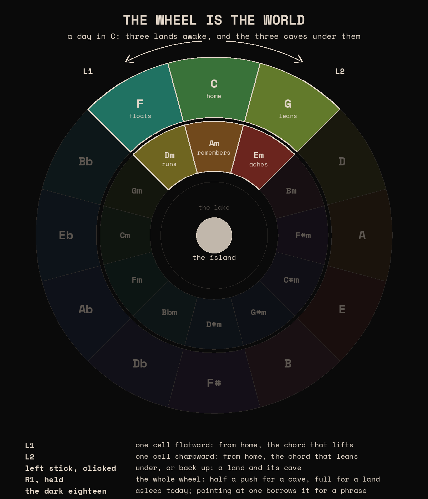
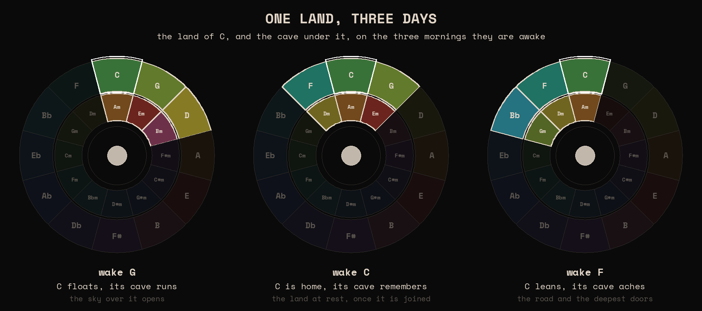

# The game

> **Status, 2026-11-26: the direction.** Morgan, of this document and its parts two and three: "this
> is absolutely 100% the direction". The rest of the repository has been aligned to them:
> `CLAUDE.md`, `README.md` and `PROGRESS.md` point here, and every older document says at its top
> what of it the direction keeps. Within the direction, "What is sure, and what is still a bet" says
> which parts his hands and ears have tested, and anything marked a candidate or a proposal is to be
> tried before it is built as settled. The game's code was built to the older specification and has
> not yet been changed to match: building it is the work ahead, and the order of that work is in
> `ROADMAP.md`.

_Written 2026-11-25 by Claude. That day Morgan said: "we need to settle on what this game actually
is ASAP. I give you Express permission to design it! I want the circle of fifths and moving and
Harmony to be the main tool". This document is the design that answers him. Where a thing is his own
decision or his own image, it says so and quotes him. Everything else was my call, made under that
permission. On 2026-11-26 he made the whole of it the direction, and it stays his to change._

_Before writing it I reread the first brainstorm with the poem, his four pieces, his inline notes in
`SCRATCH.md`, the three shapes, `thirteenth-morning.md`, `the-wheel.md`, `the-way-home.md`,
`the-page-and-the-place.md`, `memory-in-rhythm.md`, `experience-fixes.md`, `look.md`, what the seven
playthroughs found, the toys' notes and his room session. What the game does when a person starts it
today is in part four of `brainstorm-2026-11-25.md`._

_Part two is `the-depths.md`: the third, what is underneath, what moves least, rhythm and the
pocket, the great instruments, the wonders and endless composition. Part three is `the-wormhole.md`:
what the teaching of Jaron Lopez, Morgan's favourite teacher, adds. Between them they correct three
things here, and each is marked where it stands._

## In one breath

You are Hum, and you can hum one note. The world is the circle of fifths: an island in the middle of
a low, half-frozen lake, twelve lands round the shore, one for each key, and under each land a cave
that is its relative minor. Each morning on the island you put a finger down and call one of the
lands home. That key is the day. It lights three lands in a row and the three caves under them, and
those six places are the six chords you can play.

You play them with two fingers while you run. One trigger steps to the chord that lifts, the other
to the chord that leans, and stepping back is coming home. Whatever belongs to the chord you are
playing wakes up, and Hum's own body changes with it, so crossing a canyon is a chord progression,
and so is ending a fight. At dusk you lie down in running water. The river carries you to the island
asleep, your day comes back to you as eight bars of song, and the island grows by one verse.

## What I had wrong

My last three answers wrote at length about tuning and about what fights you, and never said what
the hands do with the circle of fifths every second of play. That is the centre and it was missing.
In this design harmony is in every press. Tuning is a story and five places (see "Tuning").

## The first hour, as played

1. **Black, and a drop.** A drop falls. Another. You hum, you call, and something calls back. You
   breathe with it four times and a third note comes in under you both. "Oh. You're in." The flat
   page stands up into a garden of asters as tall as cathedrals, and Drip is on your head. _This is
   in the game today, and Morgan's hands said yes to it._
2. **The first chord.** Drip hops ahead to a puddle. Out on the water is a leaf, teal, sitting low.
   Drip leans left. You squeeze L1. The whole garden takes a breath upward: the music opens,
   everything teal and green brightens, the leaf rises off the water, and Hum is suddenly light. You
   jump further than you have ever jumped and land on the leaf.
3. **The first amen.** You squeeze L2 and everything settles back down with a soft landing. You have
   played two chords and a cadence, and you used them to cross water.
4. **The other way.** From home, L2 first. The grass bends toward the middle of the garden, Hum is
   drawn along it and runs faster, and the music is asking a question. Step back with L1 on Drip's
   tick and the question is answered: everything that was leaning lands at once, and Hum is thrown
   forward with it. That is the long jump. It is also the strongest ending in music.
5. **Crossing by ear.** Half an hour in you are crossing the garden with three chords: lean to run,
   lift to leap, home to land. Each answers the instant you ask, and each one you land on Drip's
   tick rings fuller and carries you further. It sounds like a song because it is one, and you are
   choosing the order.
6. **Underneath.** By the stopped hose a well goes down. Under the garden it is dark, the roots of
   the asters hang like pillars, and you see by calling. Someone is singing down there, a note you
   have never heard in your own voice. When you fall in with them you find it there, your three
   plain chords turn warm, and three more wake under them.
7. **Dusk.** The knots come out. Each is two things pulling against each other with nothing under
   them. You put the right chord under one, ring it until it leans, hold your breath and let go on
   the one, and it comes home. The hose opens and water runs to the pool, and over its lip, and down
   a dry channel toward the lake.
8. **Night.** You lie down in the running water. The river carries you, and the day comes back as a
   short song made of what you played. You wake on an island in the middle of a low lake, with
   twelve posts round its shore and one of them lit.

## The world

### The wheel is the map

- **From above the world is the circle of fifths**, the same picture as the wheel in your hand and
  the same way up. Morgan: "the actual entire world is a gigantic circle of fifths".
- **The island is the middle.** It is the hub, as Delfino Plaza and Clock Town are (his image).
- **Twelve lands stand round the lake.** C is at the top. Going clockwise each land is a fifth
  higher: G, D, A, E, B, F♯ at the bottom, then D♭, A♭, E♭, B♭, F. Lands that touch share six of
  their seven notes. Straight across the lake two lands share only two, and those two are the
  restless pair in both.
- **Under each land is a cave**, and the cave's home note is the land's relative minor: A minor
  under C, E minor under G, D minor under F. This is the inner ring of the wheel, and it is Morgan's
  image: major lands at "ground level - can see the sky", and the relative minor "underground - like
  the depths in Tears of the Kingdom".
- **Over each land is sky.** So there are three layers, as in Tears of the Kingdom: sky, ground and
  underneath.
- **That makes twenty-four places**, twelve lands and twelve caves, one for every key there is, with
  the island in the middle and its own way down.

### A day has a key

Each morning on the island Hum wakes one post and takes that land's note for the day. The poem: "put
a finger down, call it home". The day's key decides which places are awake and what each one is
like. On a day in C:

| | one step flatward | home | one step sharpward |
|---|---|---|---|
| **under the sky** | F: it floats | C: it is home | G: it leans |
| **under the ground** | D minor: it runs | A minor: it remembers | E minor: it aches |

- **These six are the day.** Their six chords are the six chords of the key, and they are the six
  lit cells on the wheel.
- **Each is in its own mode,** and nothing was arranged to make it so. With the notes of C major, a
  tune that rests on F is Lydian, on C is Ionian, on G is Mixolydian, on D is Dorian, on A is
  Aeolian and on E is Phrygian. So the modes are how the same seven notes feel from six different
  places. The game never needs the Greek names.
- **The seventh note has no place.** On a day in C it is B, and its chord (B, D, F) is the one chord
  of the key that can't stand by itself. It is the seam of the day, and it is where trouble comes
  from (see "Trouble").
- **The other eighteen places are asleep.** They are dark and quiet and you can still walk into
  them. Being there is being outside the key (see "Outside the key").

### Three faces above, three below

This is the Super Mario Sunshine part: a land is visited many times and it is different each time,
and here the difference is which key you woke that morning.

| the day's key | the land of C | the cave under it (A minor) |
|---|---|---|
| G (C is one step flatward of home) | floats | runs |
| C (C is home) | is home | remembers |
| F (C is one step sharpward of home) | leans | aches |

Every land and every cave has these three days. On the other nine it sleeps.

| face | what it is like | what it opens |
|---|---|---|
| a land that floats | light; things drift up; one note of it is raised and hangs in the air | the sky over that land |
| a land that is home | everything is where it lives; people are in; endings land hardest | what the land only is once it is joined: its people at home, and what they give there |
| a land that leans | it tilts toward home next door; things roll that way; nothing insists | the road onward and the border |
| a cave that runs | its water moves; the dark is warm | ways through, along the water |
| a cave that remembers | its pools show what happened above | the past: what was here, who sat where |
| a cave that aches | the roof sits a half step over home, close and heavy | the deepest doors |

- **Twenty-four places with three faces each is seventy-two days to find.** A place's people,
  creatures and doors differ by face, the way Majora's Mask differs by day.
- **In theory's words:** above ground the faces are Lydian, Ionian and Mixolydian, and below they
  are Dorian, Aeolian and Phrygian. The land and its cave always share the day's seven notes.

### The lake, the ice and the rivers

- **The lake is low because the rivers don't reach it.** Each land's river is stopped by something.
  In the garden it is the knot in the hose.
- **Freeing a river joins that land to the island,** and it does three things. The lake rises. That
  land's post on the island lights, so you can wake in its key. And its voice joins the island's
  song.
- **That is what joining means.** Morgan asked that finishing something in a realm "connects the
  realm to the central hub in a meaningful way". A land you join becomes a morning you can choose,
  and that morning shows its two neighbours in faces you have never seen.
- **Parts of the lake are frozen** (his image). Ice is the treaty: the agreement that every key is a
  little wrong so that all of them connect. You can walk straight across it, which is the short way
  between far lands. Nothing rings on it. Water is the other thing: where the lake is open, sound
  carries and comes back.
- **The lake's level decides whether the world's own music comes home.** This is the rule from
  Morgan's wasatch. While the lake is low, the lands' own phrases end on almost-endings. Yours can
  land. Each river you free lets more of the world's music land with you.

### The island

- **It is where every day begins and ends.**
- **It is a clock you set.** Twelve posts stand round its shore, one facing each land. Waking a post
  is choosing the day, and a post can be woken once its land's river reaches the lake. In Majora's
  Mask the clock runs and you race it. Here you put the hand where you want it.
- **It grows.** Each night adds a verse to its song (see "Night"), and each river brings water,
  people and a new part of the island up out of the lake bed.
- **It goes down.** Under the island is one deep place that you return to all game, a level deeper
  for each river, as the Temple of the Ocean King is in Phantom Hourglass. At the bottom is where
  the lake's water goes.

### Night, and what the river is

Morgan asked whether the river that carries Hum back and "compiles Hums day/memories into it's
central reality" is a dream or sleep.

- **It is sleep.** At dusk Hum lies down in running water and the river carries him to the island
  while he sleeps.
- **The dream is the day sung back.** On the way the river sings Hum's day as eight bars, made from
  the chords he played in the order he played them, with the endings he landed.
- **Keeping.** You choose one moment of the day to keep. The rest goes into the water, and it is not
  gone: still pools can show it later.
- **The island is made of this.** The eight bars become the next verse of the island's song, and the
  moment you kept becomes a thing on the island. After a hundred days the island is a place nobody
  else has, built out of what you played.
- **You can stay up.** Dusk does not force you. Night is when the awake places sleep too and
  everything is borrowed. But nothing is kept from a day you never slept on.

## The hands

| input | does |
|---|---|
| left stick | move |
| right stick | look; all the way up is the page seen from above |
| **L1** | **the chord falls a fifth, inside the day's key** (from home, to the chord that lifts) |
| **L2** | **the chord rises a fifth, inside the day's key** (from home, to the chord that leans) |
| **left stick, clicked** | **go under, or come back up** (a chord and its relative minor) |
| right stick, clicked | lean in: Drip flies to what you are facing and ticks its time |
| **R1, tapped** | **call:** a ring of light; everything it reaches rings in its own note |
| **R1, held** | **the wheel:** time thickens; point the right stick at any cell; let go and the chord goes there |
| **R2, held** | **sing:** the chord swells, a voice entering each bar; let go on the one to land it |
| left face | strike with the fork: the next note of the chord, at once; on the beat it rings fuller |
| bottom face | jump |
| right face | dash; on the beat of something lunging at you, the dodge that opens the pocket |
| top face | take hold, talk, plant; held on anything, its name |
| D-pad | who sings with you, from the lowest voice to the highest |
| Start, Select | the songbook; pause |

- **Morgan's own decisions here:** L1 flatward and L2 sharpward during the swell ("YES WE ARE GOING
  WITH THIS RECOMMENDATION"); the wheel on a held R1 with time thickened, drawn as part of the world
  and never under foliage; half a push of the stick for the inner ring and a full push for the
  outer; a real circle of fifths with its letters; Drip asleep until rhythm matters; the right
  stick's view going all the way to the page; no glide; and a strike like the page toy's.
- **His thought, not yet a decision:** "d-pad could be used to cycle voices right? and then that
  would free up an l bumper". This design takes it.
- **What I add:** the two left triggers step the chord all the time, not only in a swell, and
  pressing the left stick down goes under. They walk the day's own ring of seven chords: past the
  lean L2 goes on into the caves, and past the lift L1 crosses the seam. (Corrected in part two.
  This first said they stepped from cell to cell round the wheel's outer ring.) That puts the three
  chords everyone knows under one finger while both thumbs are busy. The wheel is for everything
  further, and it thickens time enough to think. If the stick's click is awkward on this handheld,
  both left triggers together is the other way to go under; hands decide.
- **Why it is this way.** Super Mario Sunshine hangs a whole game on one device with a few nozzles.
  This is ours. Lift is the hover, lean is the turbo, and the step home is the launch.
- **Thumbs.** Moving and going under are the left thumb. Jumping, striking and dashing are the right
  thumb. Stepping chords is the left index finger. Singing is the right index finger. The wheel is
  the right index finger and the right thumb, and while it is open time is thick, so the right thumb
  is not needed on the face. Nothing needs the right stick and a face button at once.
- **R1 and R2 are different in kind.** R1 is stopping to choose. R2 is playing in time. Morgan could
  tell them apart in the room, and that stays.
- **The page is for reading.** From straight above, a land is flat and is the wheel's own picture.
  Morgan's thought is that this view will solve things the standing view can't, "kind of the way
  that 'paper Mario the thousand year door' does things but different". This design keeps that open
  and builds nothing on it yet.

### What holding R1 does

It opens the whole circle round Hum: twelve letters outside, twelve inside, six of them lit. It is
the map and the instrument at once.

- **The lit six are today's key.** Point at one and let go, and the chord under you goes there at
  once. This is free and it is the wheel's main use.
- **Half a push is the inner ring,** a full push the outer (Morgan's idea).
- **Resting on a cell plays it softly** before you commit, so the ear chooses before the thumb does.
- **It shows what would happen.** Everything near you that belongs to the cell you are pointing at
  lights up while you point.
- **The dark eighteen can be pointed at too.** That is leaving the key (below, and part three).
- **Held on the lift or the lean for a whole bar, it carries the day there.** The lit six slide one
  step round the wheel and you are in the next key without going back to the island. This comes
  later, and it is how someone who knows music travels (see "What grows").

## The rules

These are few on purpose. What makes Tears of the Kingdom deep is a handful of rules that multiply.

1. **Everything has a note, and its colour is its note.** The colours go round the wheel: C green, G
   yellow-green, D yellow, A orange, E red, B rose, F♯ purple, D♭ violet, A♭ blue, E♭ azure, B♭
   cyan, F teal. A call makes everything it reaches ring in its own note, so you can always find
   out.
2. **What is in the chord is awake.** A thing whose note is in the chord under Hum brightens, firms
   up and answers. A thing whose note is not rests: it dims and goes soft. So a chord is a set of
   colours, two before Hum has the third and three after, and changing chord changes what the world
   is made of.
3. **Where the chord stands to home says which way things go.** At home they hold. One step flatward
   they lift. One step sharpward they lean toward home and wind up. Underneath, the same three turn
   inward: they remember, they run, they ache.
4. **Hum is one note, and the chord decides what that note is.** His body follows (next table).
5. **Everything answers at once, and time rewards.** A chord changes the instant you ask. Asked on
   Drip's tick it rings fuller and does more, the way a timed strike does. A held breath stores, and
   letting go on the one releases all of it.
6. **Near on the wheel is kin.** A step away shares almost everything and moving there is smooth.
   Far away shares almost nothing and moving there throws things.
7. **Outside the key is a wormhole.** Point the wheel at any cell and go there, and stay as long as
   you like. What comes with you is whatever the two chords share, and Hum's own note always can.
   (Changed in part three. This first said a chord outside the key was borrowed: that it cost
   breath, lasted a phrase and always fell back.)

### One note, six bodies

Hum's note is the day's note. The chord under it decides what it is, and that decides how Hum moves
and what his singing does. On a day in C:

| chord | Hum's note is its | so Hum | and singing it |
|---|---|---|---|
| F, the lift | fifth | is light: jumps higher, falls slower | raises what belongs to it |
| C, home | root | is sure-footed and heavy: lands anything | holds, joins, settles |
| G, the lean | fourth, hanging over it | is drawn forward: runs and dashes further | tilts things toward home and winds them up |
| D minor, under the lift | seventh | slides: over water, under gates | makes things run and pass |
| A minor, under home | third | is small and close | shows what was: paths, the past, a thing's last motion run backwards |
| E minor, under the lean | sixth, aching | hits hard | shakes things at their own note until they give |

- **This was tested by ear.** Clip 26 holds one note while home moves under it. Morgan said yes to
  it, and yes to the seven moods of clip 4. One of his notes from that session reads "absolutely
  does feel like seven things". The room's write-up files his notes eighteen places off, so which
  clip that note belongs to is my reading (part two of the brainstorm note).
- **The seventh body is the seam's.** With the day's last chord under him, Hum's note sits a half
  step over its root and grinds. It breaks things. It is rare and it costs.
- **How much lighter, faster and heavier** is for Morgan's hands to find. The numbers are not
  designed here.
- **Part three proposes one rule that may replace this table:** the floor Hum's note stands on in
  each chord (`the-wormhole.md`, "The elevator"). It is a candidate, to be tried before either is
  kept.
- **The moves fall out of it.** Lean, then lift at the top of a jump, then home to land is a run, a
  leap and a landing, and it is the three chords everyone knows in an order that sounds finished.

### Coming home, four ways

How you get back to home decides what happens to everything that was leaning.

| the step | what lands | what it does |
|---|---|---|
| from the lean, home | the full close | things spring home and are thrown open; the launch |
| from the lift, home | the amen | things settle and sleep; the soft landing |
| from the lean, to the cave under home (the wheel, or a step home and a click together) | the turn | things land somewhere they didn't expect and show their other side |
| a walk of several steps, each a fifth falling | home the long way | each step adds to what the last one stored |

Morgan's ears said yes to all four (clips 17, 36, 19 and 18). In theory's words they are the
authentic, plagal and deceptive cadences and the circle progression.

### Outside the key

- **A dark cell is a chord from a sleeping place.** Point at it with the wheel and it is under you,
  for as long as you stay (part three).
- **Flatward it is sweet.** The chords on B♭, E♭, A♭ and D♭ all sit well under the day's note: over
  them C is a second, a sixth, a third and a seventh. They are the chords songs borrow from the
  darker modes on the same note, and they sound like weather coming in. Each brings its land's
  weather with it.
- **Sharpward it leans.** The chords on D, A, E and B are made major, which the key does not have,
  and each leans on the cell one step flatward of it: D on G, A on D minor, E on A minor, B on E
  minor. So with them you can lean on any chord in the key, as if it were home for a moment. Over
  them the day's note is a seventh, then a raised ninth, a lowered thirteenth and a lowered ninth,
  the altered sounds of jazz, and each one falls into a chord where Hum's note has its place.
- **Walking into a sleeping land is the same thing at the size of a place.** It is night there. A
  chord from that land wakes a patch of it for as long as you stay. (Changed in part three. This
  first said one phrase.)

## A day

Morgan asked whether this is more like Majora's Mask, more like Sunshine, or fluid. It is Sunshine's
shape with Majora's clock, and inside a day it is as free as Tears of the Kingdom.

- **Morning: choose.** On the island you wake a post. Who is where today depends on it: people keep
  their lives by key, the way Termina's keep theirs by the hour. The caravan moves three lands at a
  time. Someone you are looking for is only in the garden on days it floats.
- **Out.** The six places of the day are open. You can walk down a river bed, cross the ice, or go
  round the shore. Going round the lit lands you pass from the one that floats, through home, to the
  one that leans, and then into the dark.
- **The day is a song.** It has a dawn, a long middle and a dusk, and the land's own music tells you
  where you are in it. There is no clock on the screen.
- **What you do there** is whatever the place offers on that face: its river, the wonders, the
  people, the roots underneath, the creatures, the ways up and down. Nothing sends you anywhere.
- **Dusk: trouble comes out of the seam.** It is brief and it goes somewhere.
- **Night: the river.**
- **You cannot lose progress, only the day.** If Hum is shaken apart he falls asleep where he is and
  the river takes him early, with a shorter song.

## In every land

- **A river, and what stops it.** One large thing per land. You first meet a land on a neighbour's
  day: floating, if it lies flatward of what you have joined, and leaning, if it lies sharpward. You
  free its river on that face. Its own day, when it is home, exists only after that. So the two ways
  round the lake feel different, as they do in music: sharpward every new land leans back toward
  where you came from, and flatward every new land floats over it.
- **Flowers above, roots below.** Everything tall on the surface has a root in the cave under it.
  Wake a root from below and the thing above changes. Tears of the Kingdom ties each lightroot to a
  shrine overhead, and this is the same tie, with a reason.
- **Wonders.** Small places where one rule of harmony is the whole puzzle, the way shrines teach one
  rule each. They are solved with the chords you already have.
- **People with lives.** Each has a note and something they lean toward.
- **Creatures of that land only.** Morgan, on 2026-11-21: "All creatures should be unique and
  intentional based whatever one of 12 lands they are from".
- **A voice for your band** in most lands (see "What grows").
- **Three ways down and three ways up.** A well goes straight down to the land's own cave. A second
  way slips under the border to the cave beneath the sharpward neighbour. A third, through still
  water, comes out in the cave that has the land's own name, which lies under a land a quarter of
  the way round the lake. From C these lead to A minor, E minor and C minor. Each is a move of one
  note: G to A, C to B, E to E♭. So the caves are the short cuts, and they run by thirds where the
  surface runs by fifths.

## Trouble

- **What it is.** Everything that fights you is something that leans with nothing under it.
- **Where it comes from.** Each key has one chord that cannot stand alone, the one on its seventh
  note. Inside it are two notes pulling against each other, the fourth and seventh of the key, and
  it is the top of the leaning chord with its root missing. A knot is that, loose in the garden.
- **What you do.** Call it and it rings its notes. Put under it the chord it is the top of, and it
  stops thrashing and leans. Ring it on the beat until it is ready. Then hold your breath, step
  home, and let go on the one. It comes home and becomes something else. Nothing dies.
- **Why it is a fight.** It lunges on its own pulse while you do this. Dodging on its beat opens the
  pocket. Drip flies to whatever you are facing and ticks its time, the way the fairy marks the
  target in the Zelda games he means (Morgan: "drip as the 'Tael' of this game - love it").
- **What varies.** What is missing under a thing, which way home suits it, how its pulse sits
  against yours, how many there are and what order brings them all in, and the face of the place you
  meet it in.
- **The big ones are the rivers' stops,** one per land, each built from that land's own piece of
  harmony.
- **Two kinds come from tuning** and are kept for their places: the wolf, and what the ice has taken
  (see "Tuning").

Morgan's hands have already said the ending of a fight is right: bringing them in felt kinder than
beating them, and letting go on the higher tick felt like landing. What failed was knowing why any
of it worked. With the chord on a trigger, and the world lighting up by the chord, the why is on the
screen.

## What grows

Nothing musical is saved for the end. Morgan: "I don't want to be like you get to the end and then
you finally get to have the full circle". Every cell can be pointed at from the first evening. What
grows is how much of it rings.

Hum's voice opens one overtone at a time. Each overtone is a real one, each is a direction on the
wheel, and each is a body of theory.

| Hum's voice gains | the wheel gains | you can now | theory, in its own words |
|---|---|---|---|
| **1**, the hum | the middle | call, and keep time with Drip | pulse, call and answer |
| **3**, the fifth | the outer ring: lift and lean | cross the garden; walk round the lake | tonic, subdominant, dominant; the two closes; keys a fifth apart share six notes |
| **5**, the third | the inner ring: underneath | go down; chords turn warm; walk home the long way | major and minor; the relative minor; the turn; the six chords of a key; walks of falling fifths; the modes as places |
| **2**, the octave | how high: the voices | sing low to move what is heavy and far below, high for what is light and near | register, voicing, the bass |
| **7**, the seventh | a hook on every lean | lean on any cell; wake a sleeping neighbour; carry the day | dominant sevenths; leaning on other chords; changing key by a shared chord; the twin across the lake |

- **Before the third comes, your chords are open fifths.** Morgan called that sound "ANCIENT AND
  STRONG YES" in the room (by my reading of his misfiled notes, clip 10: a chant over an open
  fifth). The first hour begins in that sound. The first third is an event: you hear the whole world
  change. The two triggers walk the whole ring of seven from the start, because nothing is switched
  off. Before the third, the three chords past the lean are bare fifths with nowhere to go. The
  third is what opens a place under each.
- **The third is found, not given.** It is already in Hum's one note, as its fifth overtone, too
  quiet to hear in a closed hum. He finds it the first time he sings with someone who has it. Who
  that someone is belongs to Morgan. (Corrected in part two. This first said no stack of fifths
  makes a third, so Hum could not find it alone. What is true is narrower: going round the ring of
  fifths never arrives at the sweet third. It misses by 21.506 cents.)
- **The band grows.** Each voice that joins adds a part to everything you play, for the rest of the
  game: time, a bass, a tune, an inside line, a light on top.
- **The keys grow.** Each river adds a morning.
- **The song grows.** A verse a night, made of your own day.
- **The hands grow.** At the start a progression is two chords. Later it is a walk of five with a
  borrowed one in it, landed on the one, while running.

## A newcomer and a master

- **A newcomer never needs a name.** Lift, home and lean are learned in the body in the first hour.
  Underneath is learned by going down. A key is learned as a border where one colour changes. The
  order the colours change in, going round the lake, is the order of sharps and flats. A mode is a
  place on a day. A borrowed chord is weather. Names wait in the songbook until asked for.
- **A master's knowledge works the first time they try it.** Nothing is switched off waiting for a
  lesson. If you know that a walk of falling fifths stores more than one step, it does. If you know
  the chord a tritone from the lean shares its restless pair, pointing at it slides you home from
  across the lake. If you know two chords with two notes in common, the ground those notes hold
  stays solid under you while everything else changes. A master can walk into a sleeping land on the
  first night and wake it by leaning on it.
- **And still gets as much.** Knowing harmony does not tell you where the white cat is, who sat on
  the pool's edge, or what the island will be after a hundred of your own days.

## Tuning

Morgan asked: "should we even bother with different temperaments?" Yes, in five places, and never as
something the player tunes by hand.

1. **Everything rings.** Chords are tuned pure, so they are sweeter than a piano's, and locking in
   is its own reward. This is everywhere, and the player never thinks about it.
2. **The lake.** Twelve pure fifths overshoot seven octaves by 23.460 cents. So the circle of lands
   does not close. Where it should close, at the far side of the lake, one bank stands a little
   higher than the other. That gap is why the lake is low: it is where the water goes.
3. **The ice.** The treaty spreads that gap over all twelve fifths, 1.955 cents each, and the circle
   closes. On the ice you can go anywhere, and nothing rings. Morgan's ears said no to the treaty's
   land (clip 12) and yes to the pure ones.
4. **One valley with a wolf in it.** Tune eleven fifths so their thirds are sweet and the twelfth
   comes out 35.682 cents too wide, and it howls. Morgan heard it and wrote "nasty and hardcore,
   Ganon/Ganondorf energy" (by my reading, of clip 11). It is one place and one great trouble. It is
   not the weather of the game.
5. **The last river.** When all twelve run, the lake is full to the gap, and the game asks what to
   do with the remainder. That is the ending (below). After it, for anyone who wants it, the island
   has a table where the twelve small shares of the gap can be laid on the fifths any way you like,
   and each way is a tuning that people once lived in.

The older notes gave each land a tuning of its own (`spec/world.md`), and Morgan's ears liked four
of those lands (clips 9, 10, 11 and 13) and not the treaty's (12). Whether a land's own music keeps
its tuning, while Hum's chords ring pure, is open: his to settle.

Inside every key there is a smaller gap of the same kind, and the game uses it quietly. The D that
sits right in the leaning chord (9/8, 203.910 cents) and the D that sits right in the cave chord
(10/9, 182.404 cents) are 21.506 cents apart. The cave's D is the lower one. Underneath really is a
little lower.

## The story

Morgan asked whether it is still "Hum finds his voice" or "harmonize the world". It is both, and
they are one thing.

- **A note alone means nothing.** It becomes a root, a fifth or an aching sixth only when something
  is under it. So Hum cannot find his voice by himself. He finds it by putting his one note against
  everything in the world and hearing what it is there.
- **And the world needs a ground.** The lands have stopped reaching the lake and stopped hearing
  each other, and they are full of things that lean with nothing under them. One held note is the
  thing that can be under anything.
- **So the inside of the story is Hum finding his voice, and the outside is the world coming into
  harmony.** Each river is both.
- **His voice opens.** It starts as a closed hum with nothing in it. It gains the fifth, then the
  third, found singing with someone, then the seventh. By the last river it is a voice.
- **The ending is the remainder.** With every river running, the circle still does not close, and
  the poem says why: "twelve fifths overshoot home and miss forever". Three things can be done with
  the gap: freeze it shut, keep everything pure and let the lake drain, or hold it open with
  someone. The earlier notes made these three gestures you already know: a clap, a step, a hold.
  That stays. Which of them are real endings is Morgan's.
- **After it the game goes on.** The world past the lake opens in the direction the caves already
  run: by thirds.

## Two consoles

Alone, the game is whole. With JJ's console in the room, the second player is the other voice on the
same wheel. Each of you is the third the other can't make. The treaty is two wheels pointed at one
key. The cable between the two units is proven (`docs/hardware-target.md`).

## Where the game stands, and what I would build first

Looked at on 2026-11-25 (part four of the brainstorm note): the opening, Drip, the body, the garden,
the strike, a wheel with two cells that work, and a swell that already steps with L1 and L2. There
are no knots, no dusk and no river, and nothing in the world answers a change of chord.

In order:

1. **The three chords on the two triggers, everywhere.** Lift, home and lean, each changing at once
   the music, the light of the garden's things by their notes, and Hum's body.
2. **Drip shows each one where it is needed:** the leaf on the first puddle for lift, a long run
   beside the hose for lean, a high landing by the great aster for home.
3. **The well, and the three chords underneath.**
4. **The knots come at dusk,** after the peaceful time Morgan asked for, as things that lean with
   nothing under them. The hose opens.
5. **The evening ends.** Hum lies down in the water, the river sings the day back, and he wakes on
   the island with one post lit.

That is the first evening, whole. Everything after it is more places with the same hands.

(Added 2026-11-26. Morgan, after his first go on the try-out: "in order to fully feel what this game
could be and feel the world... we just gotta build the damn thing eh? let's build out an exhaustive
development roadmap". The whole road, from these five steps to the last river and past it, is in
`ROADMAP.md`. Its leg 1 is these five steps, in this order. Before them it has a leg 0, added the
same day when he asked that the world itself be "established and solid": the engine, whose shape is
in `docs/engine.md`.)

### Step one, as a try-out on the purple

Built the same day, so the design's first claim can be judged by hands and not by reading.

- **What it is.** The garden just after it has stood up, with L1 and L2 stepping the chord among the
  lift (F), home (C) and the lean (G) wherever Hum is. On the lift Hum is light: a held jump reaches
  5.2 m where it reaches 3 m at home. On the lean it runs 1.3 times as fast. Stepping home off the
  lean throws it forward, further after a long lean and further on Drip's tick. Each step sounds the
  chord's root and fifth under Hum. What is kin to the chord near Hum lights, and the nearest four
  answer softly. The ring at Hum's feet takes the chord's colour, and one line of words at the top
  names the chord for two seconds.
- **How to start it.** On the purple, in Ports: GameguyChords. Select and Start together leave. It
  is its own program beside the game: the game on that unit, its kept takes and dawns and the room
  there were not touched. What your hands do is kept as a take in `results/walks/`, named
  `chords-tryout`.
- **What it is not.** It is three cells of twenty-four. Nothing in the garden is built yet to need a
  chord: there is no leaf to lift and nothing that leans. The lift and the lean change Hum and what
  answers him. They do not yet move the world. Every number in it is a first guess for your hands.
- **What was measured** (2026-11-25). All 107 tests pass, two of them new, and with the try-out off
  the rules are as they were. On the laptop, a scripted run of twelve steps of the chord in 25
  seconds: the ears (`game/build/ears`) call 16% of it rough, the longest rough stretch 0.43 s. The
  same hands with the try-out off: 12% and 0.26 s. My first version rang the whole garden and its
  puddles on every step and measured 47% and 2.05 s, so it was replaced before it reached the
  purple. On the purple the same run made the same twelve steps and drew 1,330 frames, 39 of them
  late, with 6.04 ms of work a frame (`game/results/gameguy-chords-20261123-225843.txt`; the unit's
  clock is two days slow). The game's own last four sessions on that unit had between 10 and 526
  late frames. Nobody has heard it or held it. (Since held: on 2026-11-26 Morgan "played
  GameguyChords for a minute". His words are in the table below.)
- **Where it lives.** `chordStep` and `wakeKin` in `game/src/world/world.zig`, behind `--chords`;
  the launcher is `game/port/GameguyChords.sh`.

## What is sure, and what is still a bet

Morgan, the same evening: "the-game.md is pretty damn good so far!", and then: "we should be
absolutely sure of these kinds of things you know before we like really like go on development".

A design on paper can be made sure of three things: that it agrees with itself, that its theory is
right, and that it fits the machine. This one has been checked for all three, and the checks are in
"The arithmetic" and in the try-out's measurements. Whether it feels good can only be found by hands
and ears. So here is what the design rests on, what there is for each so far, and what would settle
it.

| the design rests on | what there is so far | what would settle it |
|---|---|---|
| stepping chords with L1 and L2 while running and jumping feels good | a first look. Morgan, 2026-11-26, having "played GameguyChords for a minute": "kinda see what you're saying about how the lift/lean can be used as actual player mechanic/movement/interaction/physics". Not a verdict yet; his take is still on the purple, unread | his hands on the chords in a garden that needs them (`ROADMAP.md`, steps 1.4 to 1.15) |
| a change of chord can be seen and understood: you know why something answered | the old wheel failed this in the room; the try-out lights what is kin and names the chord | the try-out, and then one thing in the garden that needs a chord |
| one note means different things over different chords | his ears: yes to clips 4 and 26 | settled for the ears |
| the four ways home sound like four different landings | his ears: yes to clips 17, 18, 19 and 36; in his hands, letting go on the tick "felt like landing" | settled for the ears |
| the six places sound like their six words | sketch j, unheard | his ears on sketch j |
| trouble as something that leans with nothing under it makes a good fight | half: bringing them in "felt kinder than beating them", but he won a fight without knowing why | the knots at dusk, with the chord on the trigger |
| underneath is worth going to | nothing | the well, and the cave under the garden |
| the night gives the day back as a song worth keeping | nothing | eight bars made from one of his own takes, for his ears |
| the game can hear where he puts the beat, and keeping that place is fun | his breaths landed 8 and 9 ms from the tick; nothing is built | measure how finely the triggers are timed on the purple; then the rut, as a try-out |
| leaving the key and staying sounds good while Hum's note holds | sketch l, unheard | his ears on sketch l; then the dark cells in a try-out |
| the right hand is the tune: the ground leaves out the third and the fork decides it | sketch m, unheard; the try-out's chords are already a root and a fifth | his ears on sketch m; then the fork following Hum's rise and fall, as a try-out |
| a day with a key, three lands and three caves awake, is a good shape for a world | paper only: it agrees with itself and its theory is exact | a second land beside the garden, visited on two different days |
| it sounds good on this speaker at every step | each new sound is measured; the try-out measured 16% rough against 12% without it | his ears, every time |
| the purple can draw and sound all of it | the try-out: 39 of 1,330 frames late, inside the range of the game's own sessions there | each new piece measured on the purple as it is built |
| the whole of it can be built | unknown | the first evening made whole, which shows what one place costs |

- **The first two rows are the ones everything else stands on.** If hands say no to either, the
  hands change before anything else is built.
- **My call on the order:** nothing past the first evening is built until the first evening is whole
  and Morgan likes playing it. Each piece of it goes in alone and answers one row of this table.
  (Changed by Morgan on 2026-11-26: "we just gotta build the damn thing eh?" The build now goes
  forward along `ROADMAP.md` without waiting for a verdict on each step. Each step still goes in
  alone, and this table still says what has been tested: building a thing does not make it proven.)
- **This table is not a gate and has no machinery.** It is the design saying which of its sentences
  have been tested, so that nobody, including a later model, reads the rest as proven.

## What I am dropping or parking

- **Tuning as the centre.** My twelve-shares dial is parked until after the last river.
- **"The note underneath" as the one idea.** It stays as what a cadence is and what trouble lacks.
  The one idea is now simpler: the wheel is the world.
- **Heights measured in cents** as a law of the terrain. One image is kept: the gap is a ledge.
- **The three ages and three states of trouble.** Parked. Trouble is the key's own seam. The wolf
  and the ice are places.
- **Past selves walking beside you as the spine** (shape 2's echo band). The band is friends. The
  copies did not feel like Morgan's own band in the room.
- **The mood wheel with fixed powers and a hidden ring** (the thirteenth morning's wheel). The wheel
  is the real circle with its letters. The moods are still there: they are what the six cells feel
  like.
- **The voice wheel on L1, and guard and lock-on on L2.** Both triggers are chords now. Voices are
  on the D-pad. Drip marks the target.
- **A forced order of days.** The day's key is chosen, from among the lands you have joined.

## What the older notes had, and where each stands

Added on 2026-11-26, when the repository was aligned to this direction. Every piece of the older
design a builder might meet in `SPEC.md`, `spec/`, `DECISIONS.md`, the rest of `design/` or the
code, with where it stands now. **Kept** is in the direction as it was. **Changed** is in the
direction in another form. **Dropped** is out. **Parked** is out for now, and may come back.
**Open** is not decided by the direction: it is not to be built from the older notes, and it is
Morgan's to settle or to ask for.

### The hands

| piece | where it was | now | where |
|---|---|---|---|
| the wheel on R1 held, time thickened | `SPEC.md` 9; in the code | changed: the real circle of fifths with its 24 letters; letting go puts the chord on any cell; half a push the inner ring, a full push the outer | "What holding R1 does" |
| seven moods as fixed powers (Lift, Bind, Drive, Flow, Remember, Strike, Break) | `thirteenth-morning.md`; the code's `Mood` | dropped as powers; the moods live on as what the six places of a day feel like | "Three faces above, three below"; "What I am dropping or parking" |
| a ring of twelve keys turning behind the moods each morning | `the-wheel.md` | dropped: the wheel never turns; the day's key lights six cells | "A day has a key" |
| the voice wheel on L1 | shape 1; `SPEC.md` 9 | dropped: L1 steps the chord; the voices are on the D-pad | "The hands" |
| lock-on and the guard on L2 | `SPEC.md` 8 and 10 | dropped: L2 steps the chord; clicking the right stick sends Drip to what you face | "The hands" |
| L1 and L2 stepping home in the swell | Morgan's yes, `SCRATCH.md`; in the code | changed: they step the chord at all times, round the day's ring of seven | "The hands"; `the-depths.md`, "Your third picture" |
| the swell on R2, a voice a bar, let go on the one | `SPEC.md` 9; in the code | kept | "The hands" |
| the call, R1 tapped | in the code | kept | "The hands" |
| the strike on the left face, fuller on the tick | Morgan's ask; in the code | kept; a candidate in part three has it follow Hum's rise and fall | "The hands"; `the-wormhole.md`, 8 |
| the dodge and the pocket, the dash | `SPEC.md` 10; in the code | kept | "The hands"; "Trouble" |
| the sprint, the right face held | in the code | open: the direction gives the right face to the dash and the dodge, and speed to the lean | |
| the jump, the bottom face | in the code | kept | "The hands" |
| the glide | `SPEC.md` 8 | dropped, by Morgan on 2026-11-21 | "The hands" |
| the clap, L1 and R1 together | `SPEC.md` 8; in the code | open: the ending keeps a clap as a gesture, but L1 now steps the chord, so what the two together do is not decided | "The story" |
| focus, the right stick clicked | shape 1; `experience-fixes.md` | changed: leaning in sends Drip to what you face | "The hands" |
| the hush, the left stick clicked | `thirteenth-morning.md` | dropped: the left stick's click goes under | "The hands" |
| the top face: take hold, talk, plant | `thirteenth-morning.md` | kept; held on anything, it gives its name | "The hands" |
| the D-pad | left open by Morgan, 2026-11-21 | changed: who sings with you | "The hands" |
| the songbook and pause on Start and Select | in the code | kept; names wait in the songbook | "The hands"; "A newcomer and a master" |
| the view on the right stick, round Hum and up to the page | Morgan's call; in the code | kept | "The hands" |
| Gentle and Fierce | `thirteenth-morning.md`; `DECISIONS.md` | open | |

### The world and its time

| piece | where it was | now | where |
|---|---|---|---|
| twelve lands round a lake, and their names | `spec/world.md` | kept | "The wheel is the map"; `the-depths.md` |
| each land's great instrument, metre and twelve wonders | `spec/world.md` | kept, with what each instrument is the place to learn, and eighteen wonders added | `the-depths.md` |
| thirteen mornings, each a fifth higher, sharpward only | `thirteenth-morning.md`; `SPEC.md` 6 | dropped: the day's key is chosen at the island from the lands joined | "A day has a key"; "What I am dropping or parking" |
| Repeat or Onward at the river | `thirteenth-morning.md` | dropped | "A day" |
| a day of about twenty minutes, shaped like a song | `shape-2-volta.md`; `SPEC.md` | changed: a dawn, a long middle, a dusk; its length is not set | "A day" |
| the Seam: the treaty city on its bridge, the Metronome, the Wolf in the crack | `spec/world.md` | changed: the gap is at the far side of the lake; the Seam keeps its piano; the wolf lives in one valley | "Tuning"; `the-depths.md`, "The great instruments" |
| the deep under the Mirror Pool, major turned minor | shape 1; `spec/world.md` | changed: a cave under every land, its relative minor, three ways down and up | "The wheel is the map"; "In every land" |
| the sky as a ladder of overtones, planets, light forty octaves up | `spec/sky.md` | changed: a sky over each land as the layer above; its detail is open | "The wheel is the map" |
| the hub island in a low, partly frozen lake | Morgan's image, 2026-11-25 | kept | "The island"; "The lake, the ice and the rivers" |
| the lake's level deciding whether music comes home | wasatch; shape 3 | kept | "The lake, the ice and the rivers" |
| the ferry straight across the lake | shape 3 | changed: the ice is the short way between far lands | "The lake, the ice and the rivers" |
| the islets of other equal temperaments, the Shimmer, the country with no octave | `spec/world.md` | open | |
| each land's own tuning (pure, fifths, sweet thirds, well-tempered, equal) | `spec/world.md`; shape 3 | open | "Tuning" |
| lives on rounds of three, four, five and seven mornings; the almanac | `spec/world.md` | changed: people keep their lives by the day's key; the rounds are open | "A day" |
| one to a hundred; the world's size | `spec/size.md` | open | |
| lands past the lake after the ending; songs are places | `spec/world.md` | kept | "The story"; `the-depths.md`, "Endless composition" |

### The music

| piece | where it was | now | where |
|---|---|---|---|
| chords tuned pure everywhere | shape 3 | kept | "Tuning" |
| consonant by default, dissonance brief and going somewhere | Morgan, 2026-11-13 | kept | `CLAUDE.md` |
| the seven laws of sound | `spec/laws.md` | changed: the direction's seven rules; the laws are material for building them | "The rules" |
| the four doors (full close, amen, turn, slide) | `the-wheel.md` | changed: four ways home (full close, amen, turn, the long way); the slide lives on as the twin across the lake | "Coming home, four ways"; "A newcomer and a master" |
| borrowed chords as supers that cost breath and fall back | `thirteenth-morning.md`; `the-wheel.md` | changed: outside the key is a wormhole you can stay in | "Outside the key"; `the-wormhole.md`, 1 |
| one breath for singing, the wheel and the sprint | `SPEC.md` 9; in the code | open | |
| a breath growing from three notes to seven | `memory-in-rhythm.md` | changed: Hum's voice opens one overtone at a time | "What grows" |
| choosing notes only after the ending | `DECISIONS.md` | changed: Hum is the tune; the fork plays the chord's notes; free choice of notes is not decided | `the-wormhole.md`, 8 |
| the comma heard only in rare seconds; two suns at dawn | `the-way-home.md` | changed: the gap is the lake's, and the ending's | "Tuning"; "The story" |
| sound and picture as one model; every cue a sound and a light | shape 3; `SPEC.md` | kept | `CLAUDE.md` |

### People, voices and trouble

| piece | where it was | now | where |
|---|---|---|---|
| Hum, a small creature who hums one note | `thirteenth-morning.md` | kept | "In one breath" |
| Drip: rhythm first, riding on Hum's head, asleep until rhythm matters | Morgan's yes, `SCRATCH.md`; in the code | kept | "The first hour" |
| five voices (Drip, Box Elder, Doorstop, Puffball, Patio), one per vowel | `thirteenth-morning.md` | changed: friends who join the band, one in most lands; their vowels show Hum where his overtones live; their names are open | "What grows"; `the-depths.md`, "The third" |
| the vine, who remembers and carries the third | `thirteenth-morning.md` | changed: the third is found in Hum's own voice; who first sings it with him is Morgan's | "Yours"; `the-depths.md`, "The third" |
| Jeanne and her compass | Morgan's worksheet | open | |
| Caravan No. 27, the white cat, the fly | Morgan's worksheet | kept as people in the world; their parts are open | "A day"; "A newcomer and a master" |
| ninety-six lives, eight to a land | `spec/people.md` | open: the direction keeps people with lives, not a count | "In every land" |
| every line sung; seven moods as seven answers | `experience-fixes.md` | open | |
| knots, two strands untied on the one | `SPEC.md` 10; in the code, switched off | changed: a knot is the key's seventh chord loose, something that leans with nothing under it | "Trouble" |
| Greys, the Grid's soldiers | `thirteenth-morning.md` | dropped | "What I am dropping or parking" |
| wolves made of the comma, packs at dusk | shape 1 | changed: one wolf, in one valley, one great trouble | "Tuning"; "Trouble" |
| the Grid as sameness, and the Metronome | shape 2 | parked; the grid lives on as the treaty for time | `the-depths.md`, "When" |
| bosses: the Great Knot, the Metronome, the Wolf at the Seam | `thirteenth-morning.md` | changed: the big ones are the rivers' stops, one per land | "Trouble" |
| nothing dies; things transform | `SPEC.md` 5 | kept | "Trouble" |
| what a creature leaves, by mood | `the-wheel.md` | open | |
| you can't die | `DECISIONS.md` | kept: you can lose the day, not progress | "A day" |

### Memory, the night and the rest

| piece | where it was | now | where |
|---|---|---|---|
| past selves walking beside you as a band | shape 2 | parked | "What I am dropping or parking" |
| the river at night: the day sung back; keeping four takes | shape 2; `memory-in-rhythm.md` | changed: eight bars; you keep one moment, and it becomes a thing on the island | "Night, and what the river is" |
| the eleventh dusk, a kept self going to the Wolf | `experience-fixes.md` | dropped | |
| dreams that find shortcuts; sleep that makes you better | `memory-in-rhythm.md` | open | |
| pools that remember | `memory-in-rhythm.md` | kept: the cave that remembers; still pools show what went into the water | "Three faces"; "Night" |
| the thirteenth morning's three offers: the clap, the step, the hold | `the-wheel.md` | kept as the three things that can be done at the gap; which are endings is Morgan's | "The story"; "Yours" |
| two consoles: the treaty, side by side, the cable | `design/together.md`; `spec/together.md` | changed: whole alone; the second player is the other voice on the same wheel; the cable is proven | "Two consoles" |
| the card, the pressed page, the book | `design/the-card.md` | open | |
| lines of light on black; colour by fifths | Morgan's choice, 2026-11-17 | kept | "The rules", rule 1 |
| sun-print blue for the past | `look.md` | open | |
| lives changing over years | `spec/years.md` | open | |
| takes and saves | in the code | kept | |
| the page and the place | `the-page-and-the-place.md`; in the code | kept | "The first hour"; "The hands" |
| the promise book, the stages, the board | `spec/promises.md`; `spec/stages.md` | dropped, 2026-11-25 | `CLAUDE.md` |

## Yours

- **The name of the game.**
- **Who the vine is, who sat on the pool's edge, who sat in the chair, and the odd and even
  passage.** Nothing here touches them.
- **Who first sings the third with Hum.**
- **Which of the three things at the gap are endings.**
- **Every sound.** I can't hear. Each new sound gets measured for roughness and then goes to your
  ears before it is kept.
- **Every number in the body.** Your hands.

## The arithmetic

Checked by script (`check.py`, not in the repo) on 2026-11-25.

- **The six places of a key.** With the notes of C major, the chords on F, C and G are major and
  those on D, A and E are minor; the chord on B is diminished. The modes on those roots are Lydian,
  Ionian, Mixolydian, Dorian, Aeolian, Phrygian and Locrian.
- **Hum's note over each chord,** as the day's note C: the fifth of F, the root of C, the fourth of
  G, the minor seventh of D minor, the minor third of A minor, the minor sixth of E minor, a half
  step over B.
- **Three days each.** The land of C is Lydian on a day in G, Ionian on a day in C, Mixolydian on a
  day in F. The cave under it is A Dorian, A Aeolian and A Phrygian on those same days.
- **Shared notes.** Keys one step apart on the circle share 6 notes; two apart 5; three apart 4;
  four apart 3; five apart 2; six apart 2.
- **The three ways down from C.** To A minor one note moves, G to A (10/9, 182.404 cents). To E
  minor, C to B (16/15, 111.731 cents). To C minor, E to E♭ (25/24, 70.672 cents).
- **Borrowed chords under C.** Over B♭, E♭, A♭ and D♭ major, C is the second, sixth, major third and
  major seventh. Over D7, A7, E7 and B7 it is the minor seventh, the raised ninth, the lowered
  thirteenth and the lowered ninth.
- **The restless pair.** G7 is G, B, D, F. D♭7 is D♭, F, A♭, C♭. They share B (C♭) and F.
- **The gaps.** Twelve fifths against seven octaves: 23.460 cents. Four fifths against a pure third,
  which is also the two Ds: 21.506 cents. Three pure major thirds against an octave: 41.059 cents
  short. The fifth from D at 9/8 to A at 5/3 is 40/27, 680.449 cents, against a pure 701.955. The
  wolf of quarter-comma meantone is 737.637 cents, 35.682 wide.
- **The first knot.** C and A at 1 and 5/3 are the third and fifth overtones of the F a twelfth
  below C. Three against five is the same thing slowed down.
