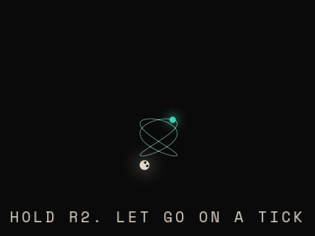
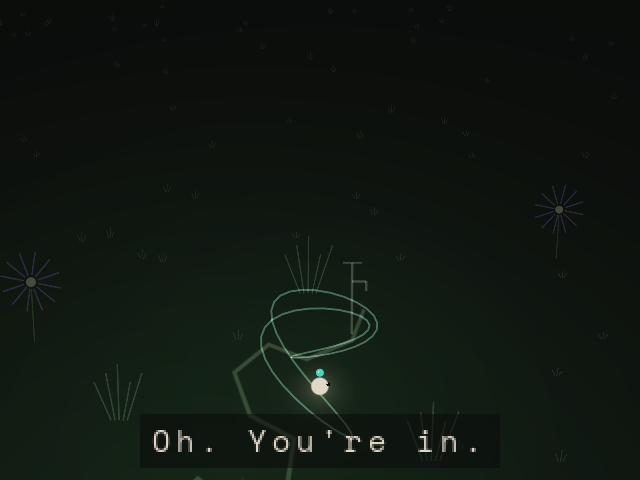
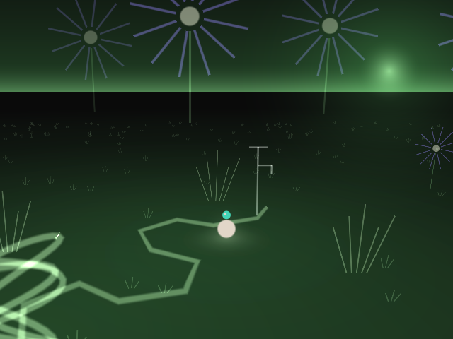
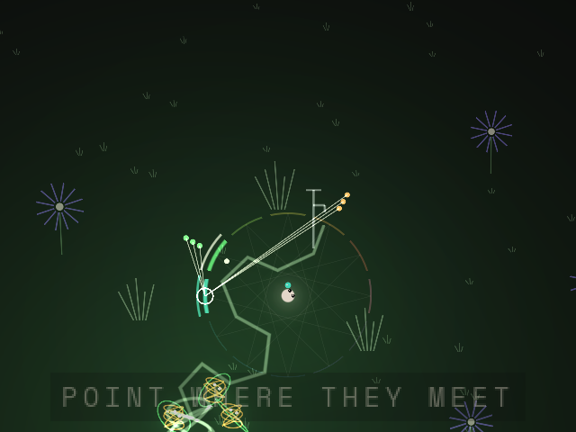

# The page and the place

_Is the game flat or deep? Both, and the music gives the reason. Written on 2026-11-14 in answer to
three questions from Morgan: if the ultimate form is 3D, should the toys be 3D; does the 2D toy
deserve to be its own thing; and should 2D be part of the 3D game's world. There is a toy for it,
`toys/page/`, and it runs on the black unit. Nothing here is decided._

## The idea in one breath

You begin in the dark with one note. Something answers, and between your two voices a flat world
appears. You see it from above, like a page.

Then a third note sounds under you both, lower than either, sung by neither. The page tilts back and
everything on it stands up: reeds, a spigot, asters as tall as cathedrals, a sky with the day coming
up in it.

For the rest of the game, holding the wheel lays the world back down so that you can read it, and
letting go stands it up around you again.

The page is where you read. The place is where you are. They are one world on one hinge.

Four frames from the toy, in order:

| | |
|---|---|
|  |  |
| two voices: a flat figure, on the page | the third note sounds, and the page tilts back |
|  |  |
| the place | hold the wheel, and it is a page again |

Two more: [a fight in the place](img/page-5-a-fight-in-the-place.png), where the yellow hoop is kin
and has no depth, and [water running](img/page-6-water.png) after the knots open.

## The three questions

**Should the toys be 3D?** Each toy should be both, and now can be.

- The rules live on the ground: where things are, when they pulse, where home is on the wheel. Only
  the picture is flat or deep.
- The page toy runs the wheel toy's rules without changing a line of them. It only adds a camera
  that can sit above the page or behind Hum.
- On the handheld both views keep up with the display, and the place costs about a tenth more work
  than the page (measured, below). So no toy has to choose.
- Ask rule questions on the page, where they are clearest. Ask "does this feel like somewhere?" in
  the place.

**Does the 2D toy deserve to be its own thing?** Only your hands can say, and they haven't played it
yet.

- My recommendation: it becomes half of the game. Every time the wheel is held, the game is the 2D
  toy.
- If you play it and love it on its own, it can also stand on its own, as a small game that stays on
  the page. Nothing would be wasted: it is the same rules and the same data.

**Should 2D be part of the 3D world?** Yes, and not as a game inside the game. Flat is what the
world is when only two are singing, and what it becomes whenever you step back to read it.

## Why it is true

The canon says the ratio between two voices is seen as "the figure between two voices". That figure
is flat, because two pulses can only draw on a plane: one moves the pen from side to side, the other
up and down.

A third pulse moves the pen toward you and away. Three voices draw a figure in space.

The canon already has that third voice, twice:

- In the first ten minutes: "a third note, lower than either of you, blooms between."
- At the end: "Then a third voice, home, sounds between you, sung by neither."

It is a real thing. Two notes sounded together can make a third, lower one, at the difference of
their frequencies. Sorge described it in 1745 and Tartini in 1754. Tartini called it the *terzo
suono*, the third sound.

The wheel toy already plays it. When you fall in with Drip, a soft note comes in at one third of the
day's note: 87.2 Hz, the low F that Hum's C and Drip's F both belong to.

So the rule is: **a body's depth is the note between its own note and home.** In the page toy three
pulses draw each creature: home's, its own, and the difference of the two.

| what it is to home | the two pulses | the pulse between | with home on C, that note is | its body |
|---|---|---|---|---|
| kin | 1 : 1 | none | none | a flat hoop |
| a fifth above | 3 : 2 | 1 | C, an octave down | solid |
| a fourth above | 4 : 3 | 1 | F | solid |
| a major third | 5 : 4 | 1 | C, two octaves down | solid |
| a minor third | 6 : 5 | 1 | A♭ | solid |
| a major sixth | 5 : 3 | 2 | F | solid |
| a minor sixth | 8 : 5 | 3 | E♭ | solid |
| a whole step | 9 : 8 | 1 | C, three octaves down | solid |
| a half step | 16 : 15 | 1 | D♭ | solid, wound tight |
| a seventh | 16 : 9 or 15 : 8 | 7 | a seventh harmonic, off the wheel | solid, wound tight |
| straight across | 45 : 32 | 13 | nothing on the wheel | a tangle |

Three things fall out of the table.

- **Sameness has no depth.** Kin has no note between, so it stays flat. That is the Grid: a day
  relived the same has no difference in it.
- **The bright side hears home under it.** The fifth, the major third and the whole step all put
  home itself underneath. The fourth and the major sixth put F there, home's neighbour a fifth
  below.
- **No body has to pass through itself.** The two numbers of an interval share no factor, so neither
  shares one with their difference. Three pulses with no shared factors are what a curve of this
  kind needs in order not to cross itself.

## One hinge

- **The page** is the ground seen from straight above. Everything that could stand lies flat on it,
  pointing away from you, the way a flower lies in a book.
- **The place** is the same ground seen from low behind Hum. Everything stands.
- **Between them is one dial.** As the eye comes down, the things come up. For most of the way the
  things keep facing you, and it is the ground that seems to tilt away.
- **The page is exactly the 2D toy's picture.** From straight above, with nothing standing, every
  point is the same distance from the eye. A test checks it to a hundredth of a pixel.

The wheel is on the same hinge, along its line from nine o'clock to three.

- `the-wheel.md` has seven lit wedges across the top and five dark ones below.
- So when the wheel stands, the seven lit wedges are an arch over Hum, and the five dark ones go
  under the ground.
- The line between lit and dark is the horizon. Notes that have set are under the earth. "The wheel
  is a sky" becomes something you can see.

## Where the page lives in the game

1. **The first minutes.** Black, one voice, a ring of light. Then two voices and the page. This
   handheld's library is 2D games, so a player takes the page for the whole game. Then the third
   note sounds and it stands up. That is the game's first wonder, and its argument, before a word is
   said.
2. **The wheel.** Hold R1, or hold a breath on R2, and the place folds to the page. Time is thick.
   Where each creature stands on the ground and where its note stands on the wheel are in one
   picture. Let go and you are back among them. The 2D toy is this.
3. **A fight.** The camera's height is the same dial. When all is calm it sits low and the sky
   shows. When creatures are near it rises a little toward the page, so the ground on your side of
   Hum can be seen.
4. **Memory.** A take is only its inputs, "a few kilobytes". It is a score. So what the river sings
   back at night is the day as a page: your path in sun-print blue, seen from above. Kept echoes
   walk the place as flat blue figures, because a recording answers nothing, and without a second
   living voice there is no note between. What you keep is pressed. What you let go stays alive.
5. **Pools.** "Sing a still pool its note and it plays the past in sun-print blue." A pool is a page
   set into the ground. Look down into it and the past plays flat on its surface. Step in to try
   again.
6. **The map.** There need be no map screen. Rise past the garden's page and the lake ring is the
   wheel: twelve lands, twelve wedges, the sun over today's. It is one lift from Hum's shoulder to
   the whole world.
7. **The Grid.** Sameness flattens. `experience-fixes.md` has a repeated day paling underfoot; here
   it also loses its depth. Grey paths are places where the world has lain down. Greys are flat, and
   bringing colour back to one stands it up. The Grid's ending is the book closing.
8. **The beloved.** The canon's vine is "blurred and doubled when you are out of tune with them,
   sharp when you are in". Here they are flat when you are out and deep when you are in. They carry
   the third your fifths can't make, so they are the one who gives your band its depth.
9. **The seam.** After twelve fifths you are back at the same wedge, seven octaves and a comma
   higher. The wheel can't show that: it has no height. The canon's table of sound and picture
   already shows the octave as height. So on the page the ring of twelve lands closes, and in the
   place it doesn't: at the seam one side of the crack stands a little higher than the other. The
   treaty city bridges a step. The page is the treaty's view, the place shows what it papers over,
   and the Wolf lives in the step.
10. **Two consoles** (an idea, untested). Alone, the third voice is the note between you and the
    world. With JJ's console linked it can be JJ: what they sing gives depth on your screen. The
    canon says it already: you are each other's third.

## Three distances

The canon has a first-person focus as well. With the page, the eye has three places to be, on one
line from far above to inside.

| where the eye is | how you get there | what it is for |
|---|---|---|
| above: the page | hold R1, or sing | reading: the wheel, a fight's pattern, memory, the map |
| behind Hum: the place | let go | being there: moving, striking, wonder |
| in Hum's eyes | click the right stick (the canon's focus) | listening to one voice |

## What the toy shows

`toys/page/` is the wheel toy's garden with a D-pad that changes how it is shown:

- **Page and place** (the default): a page until the third note, a place after, and a page again
  while the wheel is held.
- **Place only:** the wheel stands round Hum as an arch, with its dark wedges under the ground.
- **Page only:** the wheel toy's picture.

A scripted player has run it through on the black unit.

Morgan played it by hand on 2026-11-14, twice, in the default look. His first words, with a fuller
report to come: "there were some moments where it really click"; "the moments in the music and
everything ... and the beat ... it was all feeling really good"; "I do love the ... aesthetic and
... visual aspects of the thing I was playing"; "really liked the little 'oh' moment". What his two
sessions' logs show is in `toys/page/README.md`.

| on the black unit, 4,270 frames each | page and place | page only | place only |
|---|---|---|---|
| a frame, on average | 17.10 ms | 17.09 ms | 17.10 ms |
| the worst frame | 20.3 ms | 20.1 ms | 26.1 ms |
| late frames | none | none | 2 |
| the toy's own work in a frame, including working out every point of the picture | 1.31 ms | 1.29 ms | 1.44 ms |
| the busiest frame, in marks (lines, discs, glows), all in one draw call | 1,406 | 1,170 | 1,445 |
| gaps in the sound | none | none | none |

The display shows a frame every 17.09 ms, so all three keep up with it. The place costs about a
tenth more work than the page.

The meadow toy also ran on the handheld for the first time. It answers the other half of "can this
device do 3D": a solid world of 60,000 to 90,000 triangles a frame fits at full resolution and full
frame rate (8 to 12 ms of GPU). The numbers are in `docs/hardware-target.md`.

## What only hands can answer

- Does the garden standing up at "Oh. You're in." give you anything?
- In a fight, does folding to the page when you hold the wheel help you read it, or does it throw
  you out of it? Compare with "place only".
- Is a fight easier on the page or in the place?
- Does "page only" feel like its own game?
- Can you tell kin (a flat hoop) from a fifth (a solid knot) at a glance?
- Does the fold make you queasy on this screen?

## What it would change

| in | now | with this |
|---|---|---|
| the first ten minutes (canon 2) | third person from the start | a page until the third note, then it stands |
| camera (canon 5) | third person, and a focus | three distances on one line: page, place, eyes |
| the wheel (`the-wheel.md`) | a ring round Hum | the same ring on a hinge: lit wedges an arch, dark wedges under the ground |
| out of tune (`experience-fixes.md` 6) | never blur | flat instead: what is out with you loses its depth |
| echoes (canon 4) | blue selves | flat blue selves; the beloved gives them depth |
| the map | not designed | the lake seen from above is the wheel |
| toys | 2D or 3D | each is both; the hands choose |

## Not yet connected

- **Height in the rules.** The rules are on a plane. The canon has jumping, gliding and riding a
  flowerpot onto an awning. On the page, height would have to read as something.
- **What the place is made of.** This toy draws lines of light on black, as the wheel toy does. The
  look in `look.md` is solid: plaster, ink, grain. The meadow toy shows the handheld can draw it.
  Morgan's first words were for these lines of light; he has not yet tried the meadow. A later toy
  could put solid ground under these lines, if the lines want it.
- **Which note is the depth.** The toy uses the difference of the two pulses. The low note both
  belong to is another choice. They agree for the simple intervals and differ for the minor sixth.
  Sources also disagree on which of the two Tartini meant.
- **Turning the view.** The toy turns with the right stick when the wheel is shut. The canon wants
  lock-on, so that a fight needs no thumb on the camera.
- **Whether flat echoes read as tender or as cheap.**
- **The seam as a step** needs the lake ring to have height at all.

## Sources

- [Combination tone](https://en.wikipedia.org/wiki/Combination_tone) (Wikipedia): Sorge 1745,
  Tartini's *Trattato di musica* 1754 and the *terzo suono*, Helmholtz's name "difference tone" in
  1856.
- [Tartini's theory of the third tone](https://www.musikzeitung.ch/en/?p=6169) (Schweizer
  Musikzeitung): on what Tartini's third tone is and is not.
- [Lissajous knots and knots with Lissajous projections](https://arxiv.org/pdf/math/0605632)
  (arXiv): three pulses with no shared factors, and the flat figure as the shadow of the solid one.
- This repo: `thirteenth-morning.md` (sections 2, 4, 5, 10, 12), `the-wheel.md`,
  `experience-fixes.md`, `toys/page/README.md`, `docs/hardware-target.md`.
