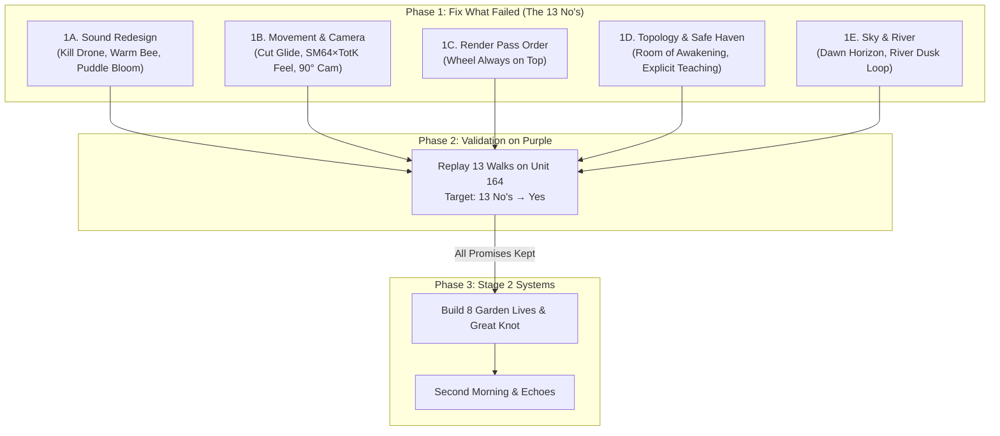

# Implementation Plan: What's Next (Morgan's Actionable Vision & Build Plan)

> **Status, 2026-11-26.** History: a build plan of 2026-11-21 for the specification's stage 2,
> written by another model. It is not the plan now: the order to build in is in
> `design/the-game.md`, "Where the game stands, and what I would build first", and in `PROGRESS.md`.

## Goal Description

Execute the next build cycle for Stage 2 of **gameguy** ("Oh. You're in.") on the purple R36S handheld (unit 164), targeting the 32 GB microSD cartridge ("TF2 GAME" slot). The immediate objective is to convert the 13 failed Room walk promises into passing promises (elevating the build from 64.9% to true felt consensus), eliminate the abrasive synth drone, make Hum's movement match the ambitious standard of Super Mario 64 × Link in Tears of the Kingdom, fix the circle of fifths render order, and establish the Garden as an intentional, safe, cinematic onboarding space before introducing conflict.

---

## User Review Required

> [!IMPORTANT]
> **Key Architecture Decisions from Morgan's Corrections:**
> 1. **Garden as Safe Haven & Pacing of Conflict:** Knots and combat will NOT attack the player early. The clearing in the reeds and the hose corral form a physical "Room of Awakening" (like Tears of the Kingdom) where the player first masters breathing with Drip, walking, jumping over the hose, and calling to the asters. Combat is introduced later, only after reaching the knot in the hose, with explicit cinematic guidance.
> 2. **Explicit Cinematic Teaching (GameguyPage Standard):** No opaque "let them wander in the dark." The game will adopt GameguyPage's cinematic pacing and visual clarity to explicitly walk the user through each mechanic as it emerges.
> 3. **Drip's Canon Lore & Role:** Drip is not an ephemeral tutorial pop-up; Drip is a canonical entity of the Garden (the drop that never finished falling, hanging at the mouth of the hose). Drip stays with Hum, perched on Hum's head, keeping the swung time of the Garden.
> 4. **The River & The Loop:** The river is the time loop and memory backbone. Dusk at the river sings back your day ("two tellings" — Clip 28). Water from the opened hose flows into the Mirror Pool.
> 5. **Minor Keys on the Wheel:** The circle of fifths must legibly account for minor keys (relative minors: C major ↔ A minor; modal moods: tenderness as minor third, fierceness as minor sixth).
> 6. **The Experiential Mandate for Open Decisions:** Morgan cannot make theoretical design choices in a vacuum. Claude will build tangible, playable, hearable options into the build so Morgan can evaluate them with his hands and ears on the handheld.

---

## Open Decisions (Experiential Strategy)

Rather than forcing abstract choices, the build will deliver playable baseline implementations that Morgan can immediately feel and hear:

| Decision Area | Built Baseline to Feel & Hear | What Morgan Will Test on Purple |
|---|---|---|
| **Swell Stepping (L1/L2 vs Stick)** | Implement R2 held + subtle stick nudge (GameguyPage feel), while exposing L1/L2 stepping as a switchable mode in the room check. | Compare both inputs directly in Walk 12 (singing-them-in). |
| **Variable Jump Height** | Build SM64/TotK standard: tap B for short hop (1.8m), hold B for full vault (5m), with air steering and coyote time. | Feel the responsiveness clearing the hose coil in Walk 3. |
| **D-Pad Allocation** | Leave unassigned for core movement. Map D-pad exclusively in debug/room mode to switch sound profiles and camera modes. | Feel if D-pad feels natural for Songbook page flipping or instrument quick-select later. |
| **Minor Keys Display** | Render relative minors on the wheel's inner circumference or alongside modal wedges. | Hear and see the transition between major (sunny home) and relative minor (tenderness/A minor). |

---

## Proposed Changes



---

### Component 1: Audio Engine & Synthesis (`game/src/sound/sound.zig`, `game/src/world/hose.zig`)

#### [MODIFY] `game/src/sound/sound.zig`
- **Hose Stopped-Pipe Drone:** Eliminate the flat, unvarying static timbre. Implement slow harmonic micro-modulation (±2 cents at 0.08 Hz) and dynamic breathing tied to bar phase. Modulate overtones based on distance and wind.
- **Continuous Feedback on R2 Swell:** While R2 is held, voices must enter dynamically each bar (root → fifth → third → seventh → ninth), swelling audibly with color brightness rather than only sounding on release.
- **The Bee (OoT Owl Warmth):** Rework the bee's synthesis from an abrasive high buzz to a warm, resonant, deep timbre (Kaepora Gaebora character).
- **Puddle Resonance Swell:** Damp the 4 dB resonance bloom on puddles down to ~2.0 dB, smoothing the onset curve to prevent seasick disorientation (Clip 32 fix).
- **High-Frequency Tinkle Reduction:** Filter out fast high-frequency leaf tinkle artifacts underfoot, retaining rich low earthy step percussion.
- **Rough Stretch Enforcement:** Ensure no rough harmonic dissonance exceeds 1.8 seconds across the entire evening scene.

```zig
// In sound.zig: add organic micro-modulation to sustained pipe voices
pub fn modulatePipe(voice: *Voice, phase: f32, distance: f32) void {
    const detune = @sin(phase * 0.5) * 0.0012; // subtle ±2 cents
    voice.pitch_ratio = 1.0 + detune;
    voice.filter_cutoff = std.math.lerp(400.0, 1800.0, @clamp(1.0 - (distance / 60.0), 0.0, 1.0));
}
```

---

### Component 2: Movement & Camera (`game/src/world/world.zig`, `game/src/world/ground.zig`)

#### [MODIFY] `game/src/world/world.zig`
- **Full-Range Camera (Ground to 90° Top-Down):** Extend `orbit_keys` so the right stick's full downward pull reaches true top-down (`pi / 2.0` radians / 90° pitch looking straight down at Hum). This eliminates the need for a separate page/place view toggle button.
- **Remove Glide:** Strip out `gliding`, `glide_sink`, `glide_voice`, and `closeGlide()`. The bottom face button in air no longer deploys a glide.
- **Variable Jump Height (SM64 / TotK standard):** Jump impulse scales based on button hold duration (short tap = 1.8m hop; sustained hold = 5.0m vault).
- **Air Steering & Coyote Time:** Allow generous directional control while airborne (TotK style) and grant 6 frames (100ms) of coyote jump time after stepping off ledges or obstacles.
- **Landing Impact & Squash:** Add visual and audible weight to landing (Hum squashes to 0.85 with brief ground-ring pulse).
- **Visible Breath Metering:** When Hum runs out of breath, visibly thin and droop Hum's line drawing; restore line thickness progressively as breath recharges.

```zig
// In world.zig: Extend orbit_keys to true 90-degree top-down page view
pub const orbit_keys = [_][5]f32{
    .{ -1.0, -0.01396, 19.0, 62.0, 0.4503 }, // low ground looking up
    .{ 0.0, walk_rise, @sqrt(cam_back * cam_back + (cam_up - hum_mid) * (cam_up - hum_mid)), place_fov, walk_pitch + walk_rise }, // walking
    .{ 0.4, 0.4712, 30.5, 53.0, 0.2321 },   // elevated
    .{ 0.8, 1.1868, 46.0, 50.0, 0.0698 },   // high perspective
    .{ 1.0, std.math.pi / 2.0, 52.0, 45.0, 0.0 }, // TRUE 90° TOP-DOWN PAGE VIEW
};
```

---

### Component 3: Render Pass & Line Ordering (`game/src/dark.zig`, `game/src/draw/aster_lines.zig`)

#### [MODIFY] `game/src/dark.zig`
- **Wheel Always On Top:** Move the drawing of `wheelLines`, `swellLines`, threads, and home indicators into a dedicated post-geometry pass.
- Ensure the wheel cannot be occluded by clover roofs, reeds, aster geometry, or terrain meshes.
- While the wheel is open, apply a subtle background brightness attenuation to keep world geometry legible but subordinate to the musical circle.

```zig
// In dark.zig: Render wheel in top-most overlay pass
// World passes first:
moving_n += aster_lines.poolLines(&world, eye, moving[moving_n..]);
moving_n += garden_lines.coverLines(&world, eye, moving[moving_n..]);

// Top-level UI & Wheel pass (guaranteed unoccluded):
moving_n += aster_lines.wheelLines(&world, moving[moving_n..]);
moving_n += aster_lines.swellLines(&world, moving[moving_n..]);
```

---

### Component 4: World Topology & Onboarding Pacing (`game/scores/garden.txt`, `game/src/world/land.zig`)

#### [MODIFY] `game/scores/garden.txt` & `game/src/world/world.zig`
- **Safe Haven "Room of Awakening":** Reconfigure the clearing where Hum wakes. Surround it with the gentle boundary of the coiled garden hose and reeds.
- **Paced Progression:**
  1. *Moment 1 (Dark & Breath):* Wake in dark, call once, Drip answers, lock breath. World stands up.
  2. *Moment 2 (Movement in Safety):* Walk inside the clearing. Learn left stick run and sprint.
  3. *Moment 3 (The Leap):* Jump over the low coil of the hose into the open garden bowl.
  4. *Moment 4 (Scale & Exploration):* Walk to the giant aster stalk (cathedral scale), call and hear the garden bell canopy answer.
  5. *Moment 5 (The Water):* Reach the Mirror Pool and puddle bridge.
  6. *Moment 6 (Conflict Intro):* Knots are ONLY encountered when following the hose toward its knot, never wandering freely in the nursery.
- **Explicit Cinematic Teaching (GameguyPage Model):** When introducing the wheel and knots, time slows cinematically; Drip hums and visual threads clearly illuminate the path from the creature to its root wedge on the wheel.
- **Drip's Permanence:** Drip hops onto Hum's head and remains Hum's traveling companion throughout the Garden, keeping time and singing the guide-notes.

---

### Component 5: The River & Minor Keys Representation (`game/src/world/home.zig`, `spec/world.md`)

#### [MODIFY] `game/src/world/home.zig`
- **Minor Keys on the Wheel:** Clearly display the relative minor pairing on the mood wheel (e.g. C Major ↔ A Minor in the Garden).
- **The River Integration:** Implement the river's flow along the perimeter down to the Mirror Pool. At twilight/dusk, resting by the river triggers the day's review ("two tellings" playback) where past actions are heard and committed to the 32GB cartridge.

---

### Component 6: Hardware & Cartridge Formatting (`game/src/plat/card.zig`)

#### [MODIFY] `game/src/plat/card.zig`
- Validate and enforce the 32 GB microSD cartridge target structure in `/roms/ports/gameguy/` on the purple console's TF2 slot.
- Ensure saves, take streams, and songbook pages write cleanly to the cartridge filesystem without latency spikes.

---

## Verification Plan

### Automated Tests
Execute the full test and verification pipeline:
```bash
# 1. Clean build and unit tests on laptop
cd /home/moth/Projects/gameguy
./game/build.sh

# 2. Run specification numbers check and promise guard
python3 -I spec/tools/check_numbers.py
python3 -I spec/tools/promises.py

# 3. Audio analysis: verify roughness < 1.8s, harmonic balance, no static drone
python3 -I spec/tools/beauty.py
```

### Manual Verification on Purple Handheld (Unit 164)
Deploy to the connected purple console and verify with physical controls:
```bash
# Push new build to the purple's 32GB TF2 card
probe/tools/r36s.sh push 164 game/dist/ports/ /roms/ports/

# Launch GameguyRoom on unit 164
probe/tools/r36s.sh run 164 /roms/ports/GameguyRoom.sh
```

**Walks to Validate (Turning 13 No's into Yes):**
1. **Walk 3 (Running):** Verify responsive Mario 64 / TotK movement feel, variable jump height over the hose coil, and camera traveling smoothly to 90° top-down.
2. **Walk 4 (Out of Breath):** Verify visible breath depletion on Hum and dynamic, breathing R2 swell.
3. **Walk 6 & 7 (Underfoot / Stalk):** Verify earthy footsteps without abrasive leaf tinkle, warm bee timbre, and monumental aster scale.
4. **Walk 8 (Puddle Bridge):** Verify smooth, non-seasick puddle resonance (~2 dB bloom).
5. **Walk 10 & 11 (The Tangles / Striking):** Verify Drip's explicit cinematic demonstration, clear threads to the wheel, and unmistakable cadence celebration upon resolving knots.
6. **Walk 13 (After the Hose):** Verify the river/hose sound breathes naturally as an open resonant pipe.

---

## The Philosophy (Morgan's Sister Insight)

> *"You go through life and you interact with the world and the more you interact with stuff, the more they start to reflect back and absorb what you've been putting out. And then lo and behold now the whole world is singing its own songs all over, and you go around harmonizing everything and making music out of it all."*

This is the North Star for every line of code, every sound synthesis buffer, and every line of light drawn in this build.
