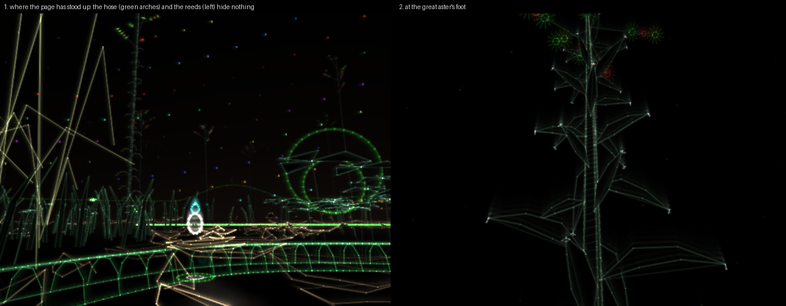
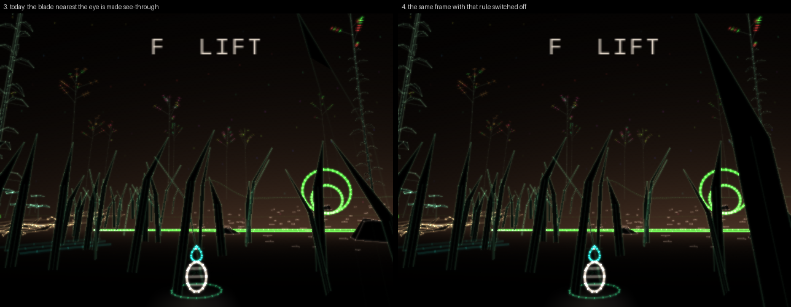

# The engine

> **Status, 2026-11-26.** An audit of the engine as it is built, and the shape it should have for
> the whole game. Morgan, that day: "the world itself... the (ideally canon/shared/modular) way the
> world and it's parts react to changes and the player and each other and different harmonic
> relationships... must be established and solid - ya? and like... objects in the world shouldn't be
> see-through/clippy right? audit and design the ultimate engine shape for this endeavor." And then:
> "I think you should do some research on the modern art of sonifying data - might inspire". The
> technical calls here are mine to make and to explain. What the game is stays in
> `design/the-game.md` and its two parts. Where this file touches what the game is, it says so and
> marks it as a proposal. Its order of work is leg 0 of `ROADMAP.md`.

_Written by Claude. For the audit I ran the laptop build with no screen from three saved starts and
through a scripted run, looked at the pictures, built three scratch copies of the game to measure
three suspicions, and read the code that draws, collides and reacts. The purple was not on the
cable, so every number measured today is from the laptop and says so. Numbers from the purple are
older and are given with their dates._

## The short answer

- **Yes to both.** The world needs one shared way of reacting, and it does not have one. And things
  should hide what is behind them and stop what runs into them, and most of them do neither.
- **The good news is underneath.** The clock, the sound, the lines of light, the takes and the rule
  that a sound always comes with a light are right, and they stay.
- **Three things are missing.** A harmony the whole world can ask questions of. One description of a
  thing that gives what is seen, what is felt and what hides. And a small set of reactions that
  every kind of thing is made from, as data.
- **The field of data sonification has a name for what this game already is.** It is a model you
  excite and listen to, which is the rare kind. Its findings give the engine one more part: a single
  table that says what every sound and every light means.

## How I looked

- **Ran it.** `--scene evening` with no screen, from `stood.save`, `foot.save` and `pool-edge.save`,
  and through the scripted run made for the chords try-out (1,300 frames).
- **Looked.** Pictures 1 to 4 below are from those runs.
- **Measured three suspicions,** each by building a scratch copy of the game with one line changed
  and comparing the same frames of the same replay, pixel by pixel:
  - a finer depth buffer (24 bits where there are 16);
  - the rule that makes things near the eye see-through, switched off;
  - a count of the lines and black triangles the garden draws.
- **Read** `src/draw/lines.zig`, `src/draw/aster_lines.zig`, `src/draw/garden_lines.zig`, the scene
  loop in `src/dark.zig`, and in `src/world/world.zig` the paths for telling, ringing, kin, moving
  home, the try-out, and everything that stops Hum; and the older engine notes the code was built to
  (`spec/engine.md`, history).

## What is there

### What is sound, and stays

| what | where | why it stays |
|---|---|---|
| the sound card's sample count is the only clock; a step of the world is 800 samples | `src/dark.zig`, `world.zig` | one take plays out the same on the laptop and the purple |
| hands stamped to the sample; Hum's own sounds start on the sound thread without waiting for a step | `src/plat/presses.zig`, `src/dark.zig` | it is why a press is heard at once |
| `tell`: the only way anything sounds, and it cannot take a sound without its light | `world.zig`, `src/world/cue.zig` | "every cue has a sound and a light", kept by the type and not by care |
| a sound is late by its distance, softer by it and duller by it | `tell` | it is how far away is heard on one speaker |
| sympathy: how much two things share is how nearly their overtones meet; kin ring their kin, late and fainter | `sympathy`, `kinOf`, `findKin`, `passOn`, `echoStep` | it is how things react to each other, and it is physics |
| one bank of resonators | `src/sound/sound.zig` | measured: at its fullest it takes a third of one core's sound buffer |
| lines kept on the GPU, each lit by its body's row in one small table | `src/draw/lines.zig` | measured on the purple: 30,000 lines a frame; the table lights a thousand things for the cost of one upload |
| the hinge between the page and the place | `lines.zig`, `world.zig` | Morgan's call, and it works |
| a take is the hands and nothing else | `src/keep/take.zig` | a day is a few thousand bytes |
| a land's layout as a text score turned into tables | `scores/garden.txt`, `tools/score.py` | it is the right way to make twenty-six places |
| the ears, the same-take check, the scripted player | `tools/`, `src/bot/` | they are how Claude can check anything |

### Why things are see-through





Five causes, biggest first.

| cause | what the code does | measured |
|---|---|---|
| **1. Most kinds of thing have no black shape.** | Lines are drawn by adding light, so a line never hides a line. Only black triangles hide, and only two families of thing have them: an aster nearer than 230 m, and what covers the ground (blades, clover, crumbs, pebbles, last year's leaves). The hose, the spigot, the reeds, Hum, Drip, the bee, the knots and the fallen flower head have none (`garden_lines.zig` gives lines only). | On the scripted run the garden picks 19,100 to 20,000 lines and 3,100 to 3,700 black triangles, and 2 or 3 of its 68 asters are near enough to have black shapes (laptop, 2026-11-26). In picture 1 the hose is the green arches: everything behind it shows through. |
| **2. Nothing that moves can hide anything.** | The black shapes are one list, set when the land is picked and picked again each 20 m the eye travels (`setLand`). There is no list for moving things. | By reading. |
| **3. Things near the eye are made see-through on purpose.** | Inside a cone from the eye to Hum, and within 3 to 6 m of the eye, lines fade and black shapes are thrown away (`inCone`, `u_cone`, in both shaders). It was the older notes' answer to "what stands between the eye and Hum". The notes said anything thin; the code does it to everything. | With the rule switched off, 5.1%, 5.2% and 3.9% of the pixels change in three frames among tall blades, and under 0.3% in two frames in the open (laptop). Pictures 3 and 4 are one of those frames: the rule had removed the blade nearest the eye. |
| **4. The depth buffer is coarse.** | 16 bits, over 0.4 m to 9,000 m, in both targets (`GL_DEPTH_COMPONENT16`; `depth_bits = 16`). By arithmetic that tells surfaces apart to 3 cm at 30 m, 38 cm at 100 m and 2 m at 230 m, and an aster's lines stand about 5 cm proud of its black core. | Small on the laptop: with 24 bits in the first pass, 835 to 1,311 of 307,200 pixels change (0.3% to 0.4%), along the horizon. Not measured on the purple. |
| **5. The trail is kept on the screen, not in the world.** | The phosphor is a half-size picture of last frame's light. When a black shape moves in front of where light was, the old light stays on top of it until it fades. | Not measured. To be looked at in motion on the purple. |

- **So it is not one bug.** The renderer can hide things, and hides well where it has shapes: the
  dark blades in picture 3 are right. Most of the world was never given shapes, and nearest the eye
  the shapes are taken away again.
- **What it costs to fix is known.** On the purple, 20,000 black triangles add 2.2 ms to a frame
  (measured with `--lines`, and recorded in `spec/engine.md`). The garden uses under 4,000 today.

### Why things can be walked through

- **Solid means a circle on the ground.** `pushOut` keeps Hum outside a circle. Each kind has its
  own function with its own radius: `atStalks`, `atReeds`, `atCovers`, `atFallen`, `atDrip`,
  `atSpigot`, and `atHose`, which alone knows a height. `solidAt` holds the same list a second time
  for questions.
- **Nothing has a top or an underside.** An aster is solid for 0.54 m round its foot and nowhere
  else: its leaves, branches and crown are passed through. Nothing can be stood on but the ground
  and the still lines of standing water. Nothing overhead stops a jump.
- **Some things are let through by rule.** Blades, moss and pebbles "let Hum through" (`atCovers`),
  so Hum walks through a drawn blade.
- **Only Hum is stopped by anything.** Nothing else in the world runs into a solid.
- **The eye is kept clear of the ground and of nothing else** (`clearance`). When a thing is in the
  way, cause 3 above makes it see-through.
- **The direction needs more than this.** A leaf that rises and is landed on, ledges that close, a
  stair, planks, gates to slide under, things that bear weight when they are awake: all need tops,
  undersides, and solids that move.

### How the world reacts today

- **One record for every thing** (`Thing`: where, how tall, its note in hertz, its family, how long
  it rings, how loud, how lit). That is a good base.
- **Things react to sound in one shared way:** a ring of a call lights and rings what it passes by
  sympathy, and what rings passes it on to its kin. This is canon already, and it is the best part
  of the rules.
- **Nothing reacts to the chord in a shared way.** The chord is one frequency (`home_hz`), with no
  members, no ground under it and no memory of the chord before. "Awake" is a set of bits named for
  the older design's moods. The try-out's `wakeKin` lights whatever shares overtones with the
  chord's root, which is near "in the chord" for fifths and octaves and wrong for thirds.
- **Nothing moves because of the chord.** No thing rises, tilts, lands or firms.
- **Each kind of thing is its own code.** Asters, reeds, the hose, the spigot, the puddles, the bee,
  Drip, the knots and the fallen head are each made by a block in `initField` and stepped by their
  own functions (`poolStep`, `knotStep`, `flyStep`, `hoseStep`, `dripStep`). A new kind is new code
  in three files.
- **One module already asks the right question.** `src/world/home.zig` works out what a note is to
  home: how many fifths away, the interval's two whole numbers, how often its pulse meets Hum's. It
  is 61 lines, used by the knots. The shape below is that idea made the centre.

### How the code is laid out

- **The rules are one file of 6,888 lines** holding one struct, with the Garden's own fields in it
  (`hose_thing`, `pools`, `bee`, `in_garden`). The Garden's layout is compiled in (`land.zig`).
- **The scene loop is one function of about 700 lines** (`run` in `dark.zig`, a file of 2,076) that
  reads the hands, steps the world, picks the land's lines, builds the moving lines by hand for each
  kind, fills the tables and draws. It knows the puddles, the hose's water, the wheel and the fight
  by name.
- **A save is the whole struct,** so it stops opening whenever a field is added.
- **107 tests,** 61 of them inside `world.zig`.

### What the older engine notes planned and the code never got

`spec/engine.md` (history) planned these, and none was built: land cut into pieces read from the
card as Hum walks; a note kept as a count of fifths, an octave and the land's tuning; sympathy found
through a grid of 16 m cells; every sound's recipe as a text file; every number of feel in one
table; a folder for places and a folder for the link. The shape below takes the note, the grid, the
table of feel and sounds as data. It drops reading from the card during play: storage stalls frames
(measured, `docs/hardware-target.md`), and a place turns out to be small enough to keep whole.

## What the art of sonifying data adds

_I did not know this field well, so I looked. What follows is my reading of the sources listed at
the end of this part._

### What the field has

- **Five ways to turn data into sound.** Playing the numbers as a wave (audification). Mapping each
  number to a quality of a sound (parameter mapping). Building a model from the data that the
  listener excites and hears answer (model-based). Short sounds from everyday life that stand for a
  thing (auditory icons). Short composed signals whose meaning is learned (earcons).
- **Nearly everyone maps.** A 2024 report on work that joins sound and picture counted 57 papers
  from 2011 to 2023. Parameter mapping was in 53. One team used a model.
- **A definition with four conditions** (Hermann, 2008): the sound reflects real properties of the
  data; the change from data to sound is systematic; it is reproducible, the same data and the same
  touches giving the same sound; and it works with other data.
- **A test** (Scaletti): the mapping must preserve inference. A listener must be able to work back
  from the sound to something true about what made it.
- **Channels come in two kinds.** Some say what a thing is, and some say how much. In that report
  timbre was the usual one for what, pitch the usual one for how much (47 of 57), and for the eye
  colour was the usual one for what.
- **Mappings that copy the world work best.** A review of 60 projects found pitch "by far the most
  used", and found that the most used mappings that do not involve pitch were nearly all natural
  ones: where a thing is to where its sound comes from, distance to loudness, energy to loudness.
- **Direction matters.** Listeners expect pitch to rise with heat and to fall with size (Walker). A
  mapping that goes against what they expect costs them accuracy.
- **A value can't be judged without context.** Clicks for time let a listener keep their place, and
  clicks at twice the rate work like large and small marks on an axis. A repeating reference tone at
  the top of the data's range "provided dramatic improvements" in judging exact values; one at the
  starting value did not help (Walker and Nees).
- **Streams.** Sounds group into streams by timbre and by when they start. Pitch can't be trusted to
  keep streams apart when pitch is carrying the data. The more sounds at once, the less each can be
  told.
- **Sound for the body.** Hearing one's own movement as sound, as it happens, helps people learn
  movements. It is faster than sight. It works when the sound fits the movement and can be
  predicted. People differ widely in how well they keep time (Bevilacqua and others; Effenberg and
  others on rowing).
- **Resonance is what makes data musical.** SYSTEM Sounds played the seven planets of TRAPPIST-1:
  one note for each orbit, each planet's pitch its orbit sped up about 212 million times, and a drum
  each time one planet passes its neighbour. The orbits stand as 2, 3, 4, 6, 9, 15 and 24, so the
  planets sound "a slightly sharp and out of tune Cmaj9 chord that is missing a 3rd". A system with
  no such ratios, played the same way, was "less than pleasing".
- **The artists say: make it music.** Loud Numbers made a heatwave heard as "louder and rougher
  sounds", and say of their own work that "using these little harmonic tricks and genre references
  to create atmospheres is very powerful". A 2025 paper argues that mapping to pitch and loudness
  alone "leaves behind melody, harmony, rhythm", and maps data to cadences and to rising and falling
  arpeggios. It also warns that chords in a row say things nobody meant.
- **A grammar** (Erie, 2024): a sonification written as data: a tone, a list of encodings (this
  number to that channel, on this scale), ways to repeat, follow and overlay, and a legend in sound
  that explains the mapping.

### What this game already is, in the field's words

| the field's word | in this game |
|---|---|
| a model the listener excites | the whole world: things are resonators, and calling, striking, stepping and singing are how it is excited |
| the data sonogram (Hermann and Ritter, 1999): a wave runs out from a point the user picks, and each data point it reaches starts to vibrate | the call: a ring runs out from Hum at the speed of sound, and each thing it reaches rings in its own note. It has been in the game since its first minute |
| reproducible: the same data and touches give the same sound | one take plays out the same on every machine |
| a reference tone | the note under Hum. The direction: "A note alone means nothing." The field's finding was for a tone at the top of a range, so it supports having a reference, and not this choice of one |
| clicks for time | Drip |
| the legend | the call: "everything it reaches rings in its own note, so you can always find out" |
| a channel for what a thing is | a thing's note. Here pitch says what, where the field uses it for how much. Colour says the same thing to the eye |
| natural mappings | distance is loudness, lateness and dullness; size is lowness; material is timbre |
| a sound for an outcome | the four ways home are four cadences |
| one number as pitch and as rhythm | "a thing's pulse is its interval" |
| a chord with no third | the first hour's open fifths. The planets play one too |
| sound for the body | Hum's legs as the drum part; the fork following his rise and fall |

This is some evidence that the design is sound. It is not proof, and nothing in the field tests a
game.

### What it changes in the engine

1. **The world's acoustics are a model, and stay one.** No sound in the game is a signal laid on
   top. Every sound is some thing answering some touch. So the engine names the touches (part 12
   below).
2. **One table says what every sound and light means** (part 12). Each quantity of the world goes to
   one quality of sound and one of light, in one direction, on one scale. Nothing else sets
   loudness, lateness or dullness. Scaletti's test is applied to every row: what can a listener work
   out from this?
3. **Where a thing is goes to the eye.** The field's most used mapping is place to where a sound
   comes from, and one mono speaker can't do it. So the engine gives place to light, and gives
   distance to lateness. This was true already. Now it is a rule.
4. **Streams, not sounds, are what the mix counts** (part 13). The try-out's first version rang
   hundreds of things at once and measured 47% rough. In the field's words it fused its streams.
5. **The two context cues are never thinned.** Drip's tick and the note under Hum are the axes of
   everything else. The mix protects them first.
6. **One number for pitch and for pulse.** A ratio of whole numbers is a thing's note against Hum's
   and also how its pulse falls against his. TRAPPIST-1's drums follow one more rule the engine
   takes: of two pulses as p to q, the faster passes the slower p less q times a cycle. So in three
   against two it passes once, and in the Garden's first knots, three against five, twice.
7. **A thing's voice is written as data,** in the grammar's shape: a tone, and what is mapped to
   what (part 6).
8. **The press-to-sound path is a hard budget.** The findings on movement say the sound must fit the
   movement and be predictable, and that sound is the faster sense. The engine already starts Hum's
   own sounds on the sound thread. That is now a rule with a number to hold (see "Budgets").

### Three proposals for the game itself

None is decided. Each is Morgan's.

- **The night's eight bars are a sonification of the day, and should be made by that craft:** start
  from the one moment kept, show one clear shape, and let the songbook's page be the legend that
  says what was mapped to what.
- **The planets over the lake could be the real TRAPPIST-1:** seven worlds as 2, 3, 4, 6, 9, 15 and
  24, sounding a chord with no third in it, as the game's first hour does, with a drum where two
  pass. The sky's detail is open.
- **What the world plays by itself is checked for what it says by accident:** a run of the world's
  own answers must not spell a cadence the player did not play.

### Sources

- Enge and others, "Open Your Ears and Take a Look: A State-of-the-Art Report on the Integration of
  Sonification and Visualization", 2024: https://arxiv.org/abs/2402.16558 (the five techniques; the
  count of 57; Hermann's definition, quoted there from his 2008 paper)
- Hermann and Ritter, "Listen to your Data: Model-Based Sonification for Data Analysis", 1999:
  https://pub.uni-bielefeld.de/record/2017409 (the data sonogram; read through summaries, the
  project's own page refused the request)
- Walker and Nees, "Theory of Sonification", chapter 2 of The Sonification Handbook, 2011:
  https://sonification.de/handbook/ (direction, scale, streams, context)
- Dubus and Bresin, "A Systematic Review of Mapping Strategies for the Sonification of Physical
  Quantities", 2013: https://doi.org/10.1371/journal.pone.0082491
- Kim, Kim and Hullman, "Erie: A Declarative Grammar for Data Sonification", 2024:
  https://arxiv.org/abs/2402.00156
- SYSTEM Sounds, "TRAPPIST Sounds": https://www.system-sounds.com/trappist-sounds/
- Bevilacqua and others, "Sensori-Motor Learning with Movement Sonification", 2016:
  https://www.ncbi.nlm.nih.gov/pmc/articles/PMC4996990/ ; Effenberg and others, 2016:
  https://doi.org/10.3389/fnins.2016.00219 (the second read through a summary only)
- Zhang, Grellscheid and Garrison, "Data Melodification FM: Where Musical Rhetoric Meets
  Sonification", 2025: https://arxiv.org/abs/2510.00222
- Ableton, "Sound the Alarm: Data Sonification as a Tool for Climate Action" (Loud Numbers):
  https://www.ableton.com/en/blog/sound-the-alarm-data-sonification-as-a-tool-for-climate-action/
- Scaletti, "Sonification ≠ Music", in The Oxford Handbook of Algorithmic Music, 2018 (read through
  summaries only)
- The Data Sonification Awards, winners 2025/26: https://www.sonificationawards.org/winners-2526
  (what the field is making now; among them a physics-based piece on tool and tissue, and SYSTEM
  Sounds' "Hearing Hubble")

## The shape

### 1. The parts, and what flows between them

```text
   hands, stamped to the sample
        |
   +----v-----+   the note, the day, the chord, the ground, the change:
   |  music   |   pure arithmetic, no world in it, every table tested
   +----+-----+
        |  what each note is, right now
   +----v-----+   reactions: wake, rise, tilt, land, slide, ring ...
   |   law    |   acoustics: waves, sympathy, kin, pulses
   +----+-----+
        |  where each thing is, how firm, how bright, what it sounds
   +----v-----+   +---------+   forms give each thing its solid,
   |  world   <--->  body   |   its black shape and its lines
   +--+-----+-+   +---------+
      |     |
      |     +--> cues, each a sound with its light --> the bank --> the speaker
      +--------> two small tables (how bright, how moved) --> lines and black shapes
```

- **Nothing lower knows anything higher.** The music knows no world. The law knows no Garden. The
  picture and the sound never reach into the world: they are handed cues and tables.
- **Every part keeps the three rules the rules already keep:** no platform, no clock, no allocation.

### 2. The note

- **A note is four small whole numbers:** how many fifths, sweet thirds, low sevenths and octaves it
  stands from the Garden's C. Its ratio is 3 to the fifths, times 5 to the thirds, times 7 to the
  sevenths, times 2 to the octaves. Hertz are worked out only at the speaker.
- **So tuning is exact and the same on every machine,** and the direction's arithmetic stops being a
  document and becomes the type.

| note | as a ratio | fifths, thirds, sevenths, octaves |
|---|---|---|
| G | 3/2 | 1, 0, 0, -1 |
| F | 4/3 | -1, 0, 0, 2 |
| the sweet E | 5/4 | 0, 1, 0, -2 |
| the E round the ring | 81/64 | 4, 0, 0, -6 |
| A | 5/3 | -1, 1, 0, 0 |
| the lean's D | 9/8 | 2, 0, 0, -3 |
| the cave's D | 10/9 | -2, 1, 0, 1 |
| the low seventh | 7/4 | 0, 0, 1, -2 |

- **Its colour is its place on the wheel:** fifths, plus four for each third, plus ten for each
  seventh, counted round twelve. The two Ds come out the same colour and 21.506 cents apart, and the
  engine knows both facts without being told.
- **A note can carry a bend,** in cents, for a thing that is off on purpose: Drip's fifth before it
  comes true, a bell that isn't quite. A thing with no note on the wheel has no colour, as now.
- **The treaty's version of a note** is its colour's place in twelve equal steps. It is what the ice
  and the Seam sound.
- **A place can bend every note it holds by a rule.** The wolf's valley narrows each fifth by 5.377
  cents, so that its thirds come out sweet, and its twelfth fifth is then 35.682 cents wide. Hum's
  pure chords meet those notes a little off, or far off, and the sympathy law does the rest: what is
  a little off answers and beats, and across the wolf nothing answers at all.

### 3. The harmony

Four things, and questions that are pure arithmetic.

- **The day:** the land called home, and which overtones Hum's voice has opened.
- **The chord:** one of the wheel's twenty-four cells, with its root, its kind (major, minor, the
  seam's) and how far the breath has opened it.
- **The ground:** the note of the place Hum stands in.
- **The change:** the chord before and the chord now.

| question | answer | from the direction |
|---|---|---|
| what are the day's seven chords, in fifths? | the ring: F, C, G, D minor, A minor, E minor, the seam | `the-depths.md`, "Your third picture" |
| what are this chord's notes? | each tuned pure to the chord's own root, with Hum's note held exactly where it was | `the-wormhole.md`, sketch l |
| what is Hum's note in this chord? | its floor: 1, 5, 9, 13, 3, 7; or 11, low 7, low 3, low 13, low 9 | `the-wormhole.md`, 2 |
| does this cell hold, lean or lift? | its distance from home, counted in threes | `the-depths.md`, "Your second picture" |
| what face does this place wear today? | floats, home, leans; runs, remembers, aches; or asleep | `the-game.md`, "Three faces" |
| what stayed, what left, and where did it go? | for each note of the old chord: stayed, or stepped up or down to its nearest neighbour in the new one | `the-depths.md`, "What moves least" |
| which way home was that? | the full close, the amen, the turn, a step of the long way, or a jump of so many cells | `the-game.md`, "Coming home, four ways" |
| does the chord stand, slide or hang? | by which of its notes is lowest: the ground's, or the low voice's | `the-depths.md`, "What is underneath" |

- **Every answer is a table made once from the note's arithmetic,** and every table has a test. The
  script that checked the three documents becomes those tests.

### 4. What a thing is to the harmony

The one record every part of the world reads. I call it a thing's **standing**. (The word is mine.)

- **In the chord, and as what:** not in it; or its root, third, fifth, seventh, ninth.
- **In the day's key, and as which of its seven.**
- **How far round the wheel** from the chord's root: kin, or far.
- **Which way it wants to go:** the key's seventh note tips up toward home, and its fourth tips
  down.
- **What the last change did to it:** stayed, arrived, or left upward or downward.
- **How true it is:** how many cents its own tuning stands from the chord's note of its colour. A
  thing a comma off is in the chord, and beats.
- **Its two whole numbers against Hum's note,** which is also how its pulse falls against his.

- **Awake is by colour, and ringing is by tuning.** A thing is awake when its colour is in the
  chord. How loudly and how cleanly it answers is by how nearly its tuning meets the chord's. Rule 2
  says a chord is a set of colours, and the sympathy law already says the rest. Keeping them apart
  is what lets the engine play the comma, the wolf and the ice with no special case.
- **It is worked out for each note in a place, not for each thing.** A place has few notes: the code
  already counts them, and allows a land 96. So a change of chord costs about a hundred small sums,
  however many things there are.

### 5. Reactions

The world's verbs. There are few, each is written once, and every kind of thing is made from them.
This table adds nothing to the direction: these are its own words, each given one meaning.

| reaction | when | what happens, once and the same for every thing |
|---|---|---|
| wake | its colour is in the chord | it brightens, firms up and answers |
| rest | its colour is not | it dims and goes soft |
| rise | awake, and the chord lifts | it lifts by its own measure, and settles when the chord comes home |
| tilt and wind | awake, and the chord leans | it tilts toward home and stores, more with time and with steps made on the tick |
| land | the full close | what leaned springs home and lets go of what it stored |
| settle | the amen | what rose comes down softly |
| turn | the lean to the cave under home | it lands on its other side |
| slide | its colour left the chord | it hands its light to its nearest neighbour, a step up or down, and what is built to move goes with it |
| tip | home is under it and it is one of the restless pair | it leans the way it wants to go |
| stand, slide through, hang | it is awake, by which note of the chord is lowest | root lowest, it locks and bears weight; third lowest, it is light and passes Hum along; fifth lowest, it holds only until the chord resolves, and then drops |
| come | its note is a fifth over the chord's root | it is drawn to Hum (the Garden's second wonder, the seed that follows) |
| thrash, lean, come home | it is two notes pulling against each other; then the chord they are the top of is put under them; then a close | it lunges on its own pulse; it stops and leans; it comes home and becomes something else |
| run, remember, ache | the three faces underneath | water moves and carries; a thing shows what it last did; a thing shakes at its own note until it gives |
| ring | struck, called, or its kin rang | it sounds, through the mix |
| fall in step | a steady pulse is near | its own pulse is drawn to it |
| stand in shapes | still water or a plate, and a note held near it | a figure of still lines |
| part | it is thin and soft, and something pushes through | it bends out of the way |

- **A reaction turns a standing into four things and no others:** how the thing is moved, how firm
  it is, how bright it is, and what it sounds. So the picture, the solid and the sound can't
  disagree.
- **Each is eased by its own numbers,** which live in the table of feel (part 19).
- **Things react to each other through the same door.** A thing that lands on a plate strikes it. A
  thing that rings rings its kin. A pulse draws a pulse. There is no second way.
- **A place's face scales them.** In a place the day has lit, reactions reach everything. In a
  sleeping place they reach only a patch round Hum, which is how a chord brought through the wheel
  wakes a patch for as long as he stays.
- **A slide has two halves.** The light passes to the nearest thing of the neighbouring colour. And
  a kind that is built to move goes with it and takes the new note: that is how two ledges a
  restless distance apart close into a third when the chord comes home.

### 6. Things and kinds

- **A thing is three facts:** where it is, its note, and its kind.
- **A kind is data:** a form (part 7), a material, which reactions it has and their measures, and
  its voice.
- **A voice is written in the grammar's shape:** a tone, which is one of the bank's families, and
  what is mapped to what.

```text
kind leaf_on_water
  form      plate  across 6  thick 0.2  floats
  material  leaf
  reacts    wake rest  rise 2.4  settle  ring  part
  voice     tone skin   ring 0.4   louder with how hard it was landed on
```

- **A new kind of thing is a few lines like those.** A new land is a score that places kinds.
  Neither is new code.
- **A creature or a person is a kind too:** a form, reactions, a pulse, and a round that says where
  it is on which day.
- **The Garden's kinds get written this way first:** aster, bell, reed, blade, clover, crumb, leaf,
  puddle, hose, spigot, drop. As each is, its own code in `world.zig` goes.

### 7. Forms

One description of a shape gives three things, so what is seen, what is felt and what hides are
always the same thing.

| form | for | its solid | its black shape | its lines |
|---|---|---|---|---|
| stalk | asters, reeds, posts, stems, the hose, the spigot | round, along a line, tapering | a prism | its edges and joints |
| plate | leaves, pads, planks, steps, ledges, boards, panes | flat, with a top and an underside | both faces | its rim and ribs |
| ball | bells, drops, crumbs, heads, Hum | round | a disc that faces the eye, or a few faces | its rings |
| block | walls, stairs, boxes | a box | its faces | its edges |
| shell | the inside of a great instrument | the same shapes, from inside | the same | the same |
| ground | a place's floor, and its water | heights by rule | the floor itself | what grows on it |
| strand | strings, threads, rays, rings of calls, sparks, stars | none | none | itself |

- **A thing is either a strand of light or a solid, and a solid hides.** That one sentence is the
  answer to see-through.
- **Three distances, as now.** Near, a form gives everything. Farther, fewer lines and a plainer
  black shape. Far, a mast and points, and no black shape: at 230 m a stalk a metre through is two
  dots wide on this screen.

### 8. Solids, and Hum's body

- **Every solid has a top, an underside and sides.** Hum can stand on a leaf, hit his head on one,
  and be stopped by its edge.
- **A grid of cells finds what is near,** as the older notes planned. Solids that move are put in
  their new cells as they go.
- **Hum is a small round body** (0.36 m, as now) moved by one routine: where his legs, a jump, a
  throw or a platform would take him, and then what is solid says how far he gets. He slides along
  what he meets, steps up 0.3 m, and is carried by what he stands on.
- **Hum's body follows the chord through that one routine.** Its weight, speed, jump, grip, size and
  blow are a row of numbers for each floor his note can stand on. Light, sure-footed, drawn forward,
  sliding, small and hitting hard are six rows.
- **Firm and soft are one number on each solid,** set by its reaction. A firm plate bears him. A
  soft one sags under him and sheds him. A soft thin thing parts round him. A soft big thing only
  dims and stops answering. Nothing soft is ever passed through. (That reading of "soft" is a
  proposal, for Morgan's hands.)
- **The same questions serve everything else:** what a creature runs into, what the fork can reach,
  what Drip is facing, what the eye can see past.

### 9. The eye

- **The eye is a small solid too.** It is never nearer than 0.6 m to anything, so the screen's near
  edge can never cut through a thing. (By today's numbers: the near edge is 0.4 m off and the view
  55 degrees tall, which puts its corners 0.53 m from the eye.)
- **Nothing is made see-through.** The cone and the fade near the eye go.
- **When something big comes between the eye and Hum, the eye moves:** in along its line first, then
  up.
- **When something thin and soft comes between, it parts.** Blades and reeds bend out of the line of
  sight by the same reaction that parts them round Hum. (Proposal, for his eyes.)
- **If Hum is still hidden,** his own light shows on the black shape in front of him as a dim ring.
  The thing stays solid and dark. Only his light is let through. (Proposal, for his eyes.)

### 10. Hiding

- **Every solid's black shape is drawn,** by one list for what stands and one for what moves. The
  second is rebuilt each frame and is small: Hum, Drip, creatures.
- **A thing that only rises or tilts needs no rebuilding** (part 11).
- **24 bits of depth** in both targets.
- **A line stands a little proud of its own solid,** by a pull toward the eye that grows with
  distance, so a shape never eats its own edges and far lines don't flicker.
- **A trail dies where a nearer black shape now covers it,** if looking at it in motion shows the
  ghost is there.
- **Far lands are dark shapes with lights on them,** a few hundred triangles each by estimate, so a
  land hides the lights behind it.

### 11. The world moves by table

- **Today one small table says how bright each body is,** and the GPU reads it at every corner of
  every line. That is why a call can light a thousand things at no cost.
- **A second table says how each body is moved:** lifted, tilted about its own foot, slid. Lines and
  black shapes both read it, and the solid is moved the same way by the same numbers.
- **So a change of chord can raise every leaf and bend every blade in the Garden at once,** and the
  cost is writing a few hundred rows. No line is built again.
- **Parting is done the same way.** Each end of a line knows how far up its own thing it is, and the
  GPU bends it away from Hum and from the line of sight.

### 12. The world is an instrument: touches, and one table of meaning

- **Five touches.** A wave (the call) asks everything it reaches. A knock (the fork, a footfall, a
  landing) asks one thing, hard. A bow (the swell, a held hum) asks slowly, and builds up. A pulse
  (Drip, a creature, a knot) asks again and again, and draws others into step. A change (of the
  chord) asks nothing: it changes what everything is, and what was sounding is heard as something
  else.
- **One table of meaning,** written once and used by `tell` and by the picture. It is the engine's
  answer to "what can a listener work out from this?"

| what is true in the world | heard as | seen as |
|---|---|---|
| which note a thing is | its pitch | its colour |
| what it is made of | its family of overtones | how its lines are drawn |
| how big it is | lower, and ringing longer | its size |
| how far it is | later, softer and duller | fainter and thinner |
| where it is | (one speaker can't say) | where its light is |
| how hard it was touched | louder and brighter | brighter |
| whether it is in the chord | it answers | it is bright and firm |
| how true it is to the chord | clean, or beating | steady, or shimmering as fast as it beats |
| how much of Hum's voice is open | more overtones | more rings |
| how its pulse falls against Hum's | two rhythms meeting | two figures meeting |
| where the beat is | Drip | Drip |
| what everything is measured from | the note under Hum | the ring at his feet |

- **Two rows are axes and are never thinned:** the last two.
- **One row is carried by the eye alone.** Every other row is said twice, once to each sense.

### 13. Sound: the bank, streams and the mix

- **The bank stays.** It gains hertz from notes, six held voices where it has four, a family for
  each great instrument, and the treaty's tuning.
- **The mix counts streams.** Hum's own voice and fork. Drip and the beat. The ground and the land's
  own music. The friends. What answers. Each stream has its own family, and what answers is spread
  in time by its distance, which is what keeps it apart from what Hum plays.
- **Each touch may sound only so many answers;** the rest answer with light alone. The try-out lets
  four sound for a step of the chord, which measured 16% rough against 12% with none.
- **The mix keeps a count of roughness.** Before a sound is told, its overtones are set against what
  is ringing now, by the same sum the ears tool uses. Over the count, it is told softer or as light
  alone. So "consonant by default" is kept by the engine and not by care. The count rises where the
  design wants roughness: a knot, the wolf, the seam. (Proposal. Its cost is to be measured.)
- **It is all on the world's side,** so it is in the take and plays out the same everywhere.

### 14. Time

- **The beat is a module,** as the note is: a place's metre, how late its off-beats fall, where the
  one is, and the pace.
- **Any press can be asked where it fell:** on the beat, on the off-beat, or a hair before. That is
  the direction's land, lift and lean in time.
- **The pocket is kept there:** where the player's presses keep falling, and how steadily.
- **A thing's pulse is its ratio against Hum's note,** and where two pulses meet is worked out from
  the ratio.

### 15. Places and the world

- **A place is tables made from its score when the game is built.** Nothing is read from storage
  during play.
- **Positions are counted from each place's own middle,** so numbers stay small and exact however
  wide the world is.
- **The place Hum is in is stepped in full.** Its neighbours are drawn as far things and keep only
  what the day sets. Which is which depends only on where Hum is, so a replay agrees.
- **Places are made on the spare core while the opening is still dark,** nearest first. By
  arithmetic the Garden's aster models are about 6.6 MB (68 asters, each in arrays of about 97 KB);
  twenty-six places at that size is about 170 MB of the 815 MiB free when a game starts. That is an
  estimate, to be measured.

### 16. What is kept, and two Hums

- **Three things are kept, and they are different.** A take is the hands. A save is the world at a
  dawn, for opening that dawn again in the build that made it. And what lasts is a small file of
  named facts that every later build can read: rivers, verses, kept moments, the voice, the rut.
- **Hum is a record, and there can be two.** A step takes two pairs of hands. A take holds both.
  Nothing else in the engine counts players. What two Hums do to one harmony is leg 4's to find with
  JJ; the engine only makes sure nothing assumes one.
- **Writing waits for the night.** Storage stalls frames (measured), so a day's take is held in
  memory and saves are written at the river, when nothing is moving.

### 17. One step, in order

1. The hands, with their stamps.
2. The harmony: the triggers, the wheel and the breath move the chord. If it moved, there is a
   change.
3. Standings, for each note in the place, only if something changed.
4. Reactions ease toward what their standings ask: moves, firmness, brightness.
5. Bodies: Hum and whatever else moves, against what is solid.
6. Touches and what answers them: waves, knocks, kin, pulses. Each through the mix, each told with
   its light.
7. The beat and the pocket. The band. The day.
8. The eye.

Out come cues for the bank and the two tables for the picture.

### 18. The source tree

```text
game/src/
  music/   note, wheel, day, chord, change, tuning, beat: no world in it
  law/     standing, reactions, touches, sympathy and kin, the table of meaning, the mix
  body/    solids, the grid, Hum's moving, the eye
  place/   the tables made from scores; the kinds; forms
  world/   what is stepped, and the order of a step; Hum, Drip, the band, the day, the night
  sound/   the bank, the families, the voices
  draw/    lines and black shapes on the GPU; forms to lines; the two tables; the wheel; songbook
  keep/    takes, saves, what lasts
  plat/    the window, the sound card, the stamped hands, the card
  bot/     the scripted player
  feel.zig every number a hand or an ear will want changed
```

- **`world.zig` shrinks as each part leaves it.** It ends as the order of a step and the state.
- **The scene loop stops knowing any thing by name.** It steps, hands cues to the bank, hands tables
  to the picture and draws.

### 19. Feel in one table

- **Every number that hands or ears will want to change lives in one table,** as the older notes
  planned and the toys did. The bench (`ROADMAP.md`, 1.2) is that table shown on the pause screen.

### 20. What the engine is not

- **Not a physics engine.** Things move by their reactions and by rule. There are no forces between
  bodies, no stacking and no tumbling. What looks like physics is harmony.
- **Not a mesh engine.** There are no models, textures or bones from files. A thing is a form and
  its lines.
- **Not a sample player.** There are no sound files. Every sound is the bank.
- **Not general.** It is built for one world made of notes, and everything in it is a consequence of
  that.

## Budgets

Every rate here was measured on the purple unless it says otherwise. The plans are sums from those
rates, and each is measured again when it is built.

| what | measured | plan |
|---|---|---|
| the three passes | 4.4 ms (`spec/engine.md`) | the same three |
| lines | 0.22 ms a thousand; 30,000 in 11.1 ms (2026-11-19) | 24,000, about 5.3 ms |
| black triangles | 20,000 add 2.2 ms | 12,000, about 1.3 ms, where the Garden draws under 4,000 today (laptop count) |
| the GPU in all | 30,000 lines with 5,000 black triangles: 11.1 ms | about 11.0 ms by those sums |
| the second table, and parting | not measured | measured in step 0.12 before anything is built on it |
| one core's sound | 2,100 overtones in half a buffer; 926 of 2,667 microseconds at the fullest so far | six voices and the mix inside the same half |
| the mix's count of roughness | not measured | measured in step 0.10 |
| a press to its sound | Hum's own sounds are started on the sound thread from the stamped press (`src/dark.zig`); the older notes give one buffer, 2.67 ms; not measured today | measured, and then held: nothing Hum does waits for a step |
| a frame's work | the try-out's run: 6.04 ms a frame, 39 of 1,330 frames late (2026-11-25) | no more late frames than that with leg 0 in |
| memory | 815 MiB free at the start of a game | all places kept whole: about 170 MB, an estimate |

## What changes in the code, and in what order

This is leg 0 of `ROADMAP.md`, where each step is written out.

1. **The music, as its own module,** with the three documents' arithmetic as its tests. Nothing in
   the game changes yet.
2. **Forms, and the Garden's kinds as data.**
3. **Hiding:** every form's black shape; a list for what moves; 24 bits; lines proud of their
   solids.
4. **Solids, and Hum's one routine.**
5. **Soft things part.**
6. **The eye,** and then the see-through rule is taken out.
7. **The second table.**
8. **The first reactions** on the try-out's three chords: wake, rest, rise, tilt and wind, land,
   settle, ring.
9. **Touches, the table of meaning, streams and the mix.**
10. **The rules file split by the step's order,** and the scene loop made blind to kinds.
11. **All of it measured on the purple.**

## Mine, his, and not yet measured

- **Mine, and decided here:** the note as whole numbers; the standing; reactions as the only way a
  thing changes; forms; the grid; the second table; streams; the tree. They are how, not what.
- **His, for his eyes and hands:** what soft does under Hum; whether thin things part for the line
  of sight; whether Hum's light shows through what hides him.
- **Not yet measured on the purple:** the finer depth buffer; the second table and parting; the
  mix's count; twelve thousand black triangles together with twenty-four thousand lines; whether
  trails ghost.
